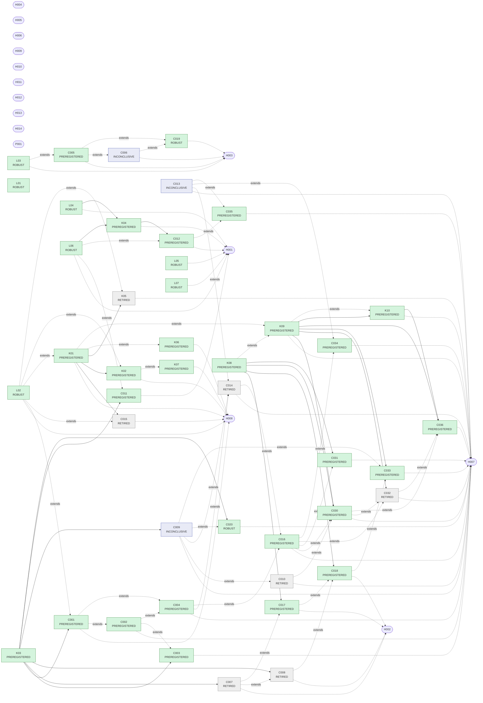

# MIND — computed knowledge snapshot

> **Generated snapshot** by `python -m mind status --write` from `knowledge/claims/`, `knowledge/records/` and git history. It reflects the last generation, not current Git HEAD. Do not edit it by hand; regenerate after changes or merge conflicts.

Result-code fingerprint `db4b2fa5bc8fc13b` · snapshot generated 2026-10-11 15:05 UTC

**Target: functional consciousness — NOT achieved.** Every claim below concerns a small learning organism in toy worlds, at instrument, behavioural (L1) or causal-organisation (L2) scope. Phenomenal experience (L3) is not an admissible empirical scope here.

## At a glance

| state | claims |
|---|---|
| ✅ HOLDS | 34 (PREREGISTERED 25, ROBUST 9) |
| ❔ INCONCLUSIVE | 3 |
| 🗄️ RETIRED | 7 |

**CURRENT_CODE_UNVERIFIED:** 1 claim(s) (C019) rest on evidence recorded under other result code. Their RIVAL-TESTED-or-higher standing is suspended until it is re-recorded (see the frontier).

Evidence ladder (computed, never asserted): PROPOSED → OBSERVED → ROBUST → RIVAL-TESTED (effects only) → PREREGISTERED (commit-sealed held-out seeds) → REPLICATED (second contributor and environment). See [docs/CLAIMS.md](docs/CLAIMS.md).

## Frontier — what to build next

Derived from the knowledge itself (broken first, then stale, then promotions and open questions). Pick one, check open PRs for overlap, contribute. See [GO.md](GO.md).

1. **[refresh]** CURRENT_CODE_UNVERIFIED: evidence for C019, C020 predates the current result code, so the RIVAL-TESTED-or-higher standing of C019 is suspended; re-run `python -m mind check --record`, and `--heldout --record` for claims with sealed seeds
2. **[sharpen]** C006 (Without distractors the bottleneck is neutral) is inconclusive: the interval straddles its margin. Register a sharper successor claim (more seeds, a cleaner world) — never edit C006's prediction to fit
3. **[sharpen]** C009 (Memory improves control of an unreliable tool (off-home effect)) is inconclusive: the interval straddles its margin. Register a sharper successor claim (more seeds, a cleaner world) — never edit C009's prediction to fit
4. **[sharpen]** C013 (Self-knowledge improves causal decisions (cross-function)) is inconclusive: the interval straddles its margin. Register a sharper successor claim (more seeds, a cleaner world) — never edit C013's prediction to fit
5. **[sharpen]** C020 (Silent-outage memory effect at higher paired precision) holds now but failed its first sealed confirmation, so its held-out seeds are spent: register a successor claim (new id, fresh seeds) to confirm it prospectively
6. **[rival]** C020: rival(s) window4 match the mechanism. Beat them with a better organ, or register that the simpler rival suffices
7. **[question]** H004 — Does recurrent processing integrate over time better than matched feed-forward access to more context? No claim yet. Add a `recurrent` organ (a small learned state vector updated every tick and broadcast) and compare it with window rivals of equal information in vigil/long and outage/silent.
8. **[question]** H005 — Do homeostatic drives and active sampling stabilise goal management under changing resources? No claim yet. Add a resource world (energy/attention budget that must be maintained) and a `drive` organ; the rival is reward shaping with the same information.
9. **[question]** H009 — Does structured affective/social regulation improve consent-respecting coordination? No claim yet. Requires a simulated-social world with consent and correction events; design it with an explicit anti-manipulation metric before any affect organ is added. Ethics review first (see AGENTS.md).
10. **[question]** H010 — Do efference copies improve attribution of self-caused versus external change? No claim yet. Add a `poltergeist` world (external events confounded with the agent's own actions) and an `efference` organ predicting the sensory consequences of its own acts; rival = a generic state estimator with equal information.
11. **[question]** H011 — Does impasse-triggered procedural learning transfer on the first try after a hard reset? No claim yet. Needs a family of worlds sharing latent failure structure but differing in surface symbols; the organism's tabular policy cannot transfer across symbols, so this question first needs a representation that can.
12. **[question]** H012 — Does multi-timescale learning improve durable transfer without unacceptable forgetting? No claim yet. Use scheduled lesions (`@E:modifier`) and variant switches mid-life to measure acute deficit, recovery and retention of the earlier competence.
13. **[question]** H013 — Do the organism's self-reports track the states that actually drive its actions? No claim yet. Add a report probe that states, from the organism's own broadcast (`pending=`, `self:`, `was:`), what it will do next, and score reports only by how well they predict the next action, never by how they read. The rival is a narrator with no access to internal state (v1 PR #11's zero-read narrator, strengthened to read the same transcript). Then use access lesions (`cut:X>policy`), which keep a content reportable but cut it from action, to test whether report validity falls exactly where the causal path is cut.
14. **[question]** H014 — Can a broadcast consumer learn which contents to integrate? No claim yet. Add consumer-side selection as an organ parameter (e.g. `self_model.gate=learned`, where each consumer learns a per-source trust weight from its own prediction error, or keeps its own top-k of the broadcast). Test whether it removes the self-model's carry cost (C030: at fixed behaviour, carrying memory's features costs about +0.010 Brier in vigil beyond what knowing they are present is worth) and the policy's carry cost for the self-model's contents (C034) without losing memory's dual use (C033). Measure the self-model side with shadows, the policy side with cuts.
15. **[question]** P001 — Can held-out seeds come from randomness the registrant does not control? No claim yet. Derive held-out seeds from a public randomness beacon round fixed after the claim is pushed (record the round in the record), or have seeds drawn at merge time by someone other than the registrant; then update `mind/claims.py` and the doctor.
16. **[question]** H001 — Does causal autobiographical memory improve action beyond compact state? Build a `causal` organ that infers structure from recalled probe results WITHOUT being handed the E001 graph family (that would inject the oracle), then test it in workshop against rival:bayes, rival:window4 and the plain organism. The Day-2 lesion is then `-causal` with memory intact.
17. **[question]** H002 — Does a predictive self-model improve calibration and adaptation after hidden capability change? First add v1 PR #15's event-aware rival (the success table, also updated by the public `alert=down`/`alert=up` announcements) as a second same-event scorer, and test whether it closes C017's margin in outage/dev; register the result either way. Then add a capability-shift world where an action's reliability changes abruptly and silently; test whether the self-model's surprise signal speeds re-adaptation (acute vs recovered deficit) against both table rivals.
18. **[question]** H003 — Does a capacity-limited global workspace help, and when does it hurt? Map the capacity curve (K = 1..8, inf) across all worlds and variants; find the distractor-load / retention-length boundary where the bottleneck flips from helping to hurting.
19. **[question]** H007 — Is the organism's causal organisation integrated rather than modular? Extend shadows (mind/shadow.py) beyond the self-model. Give the policy a fixed-behaviour estimand (off-policy replay of its TD learner on the logged stream with one source's contents dropped or shammed, scored by agreement with the logged greedy actions or by TD error), then make the atlas report each cell twice: the total effect (lesion) and the informational effect (shadow). Re-run whenever an organ or world is added; register a claim when an informational cross-function effect appears or disappears.
20. **[question]** H008 — Does genuinely maintained internal state produce useful prospective action without prompting? Add idle ticks with a compute budget and a `maintenance` organ; compare against a learned external scheduler with the same inputs (v1 issue #3's rival), measuring prospective action quality per unit compute.

…and 1 more: `python -m mind status --frontier`.

## Claims

| claim | statement | kind · scope | state | level | evidence (decisive run) | rivals not beaten | premises |
|---|---|---|---|---|---|---|---|
| [C001](knowledge/claims/C001_commitment_needs_memory_or_goals.py) | **Commitments across a gap need memory or goals** | effect · L2 | ✅ HOLDS | PREREGISTERED | Δ +0.875 [+0.779, +0.964] (0.900 vs 0.025, n=16) · held-out | – | K03 |
| [C002](knowledge/claims/C002_goals_dispensable_when_memory_compensates.py) | **Goals are dispensable on short gaps (memory compensates)** | equivalence · L2 | ✅ HOLDS | PREREGISTERED | Δ -0.035 [-0.069, +0.000] (0.919 vs 0.954, n=16) · held-out | n/a | – |
| [C003](knowledge/claims/C003_goals_essential_on_long_gaps.py) | **Goals are essential on long gaps** | effect · L2 | ✅ HOLDS | PREREGISTERED | Δ +0.528 [+0.422, +0.635] (0.537 vs 0.009, n=16) · held-out | – | K03 |
| [C004](knowledge/claims/C004_memory_goals_degeneracy.py) | **Memory and goals back each other up (degeneracy)** | effect · L2 | ✅ HOLDS | PREREGISTERED | interaction +0.800 [+0.746, +0.854] (claim: > 0.4) · held-out | – | – |
| [C005](knowledge/claims/C005_bottleneck_helps_under_distractors.py) | **The workspace bottleneck helps under distractor load** | effect · L2 | ✅ HOLDS | PREREGISTERED | Δ +0.136 [+0.084, +0.189] (0.869 vs 0.733, n=16) · held-out | – | – |
| [C011](knowledge/claims/C011_no_causal_advantage_in_workshop.py) | **The organism gives no advantage over a reactive learner at causal probing** | equivalence · L2 | ✅ HOLDS | PREREGISTERED | Δ -0.035 [-0.063, -0.008] (-1.691 vs -1.655, n=16) · held-out | n/a | K03 |
| [C012](knowledge/claims/C012_organism_far_from_bayes_optimum.py) | **The organism remains far from the Bayes-optimal causal policy** | threshold · L2 | ✅ HOLDS | PREREGISTERED | 0.506 [0.476, 0.537] >= 0.3 (n=16) · held-out | n/a | K04 |
| [C016](knowledge/claims/C016_integration_holm_corrected.py) | **Integrated, not modular (Holm-corrected, distinct organs)** | effect · L2 | ✅ HOLDS | PREREGISTERED | Holm-corrected: 2 organ(s) with off-home help ['goals', 'memory']; 2 degenerate pair(s); causal density 0.33 · held-out | – | – |
| [C017](knowledge/claims/C017_self_model_beats_table_same_events.py) | **Self-model beats a success table on the same events (announced outages)** | threshold · L2 | ✅ HOLDS | PREREGISTERED | 0.021 [0.017, 0.026] >= 0.008 (n=16) · held-out | n/a | K08 |
| [C018](knowledge/claims/C018_self_model_beats_table_when_silent.py) | **Self-model beats a success table on the same events, even when outages are silent** | threshold · L2 | ✅ HOLDS | PREREGISTERED | 0.008 [0.005, 0.010] >= 0.004 (n=16) · held-out | n/a | K08 |
| [C019](knowledge/claims/C019_low_load_bottleneck_equivalence_precision.py) | **Low-load workspace bottleneck is equivalent to unlimited access (high precision)** _CURRENT_CODE_UNVERIFIED: its PREREGISTERED standing rests on evidence recorded under other result code, so it is suspended at ROBUST until `python -m mind check --record` and `--heldout --record` re-record it on the current code_ | equivalence · L2 | ✅ HOLDS | ROBUST (PREREGISTERED suspended) | Δ -0.014 [-0.033, +0.006] (0.894 vs 0.907, n=128) · held-out | n/a | – |
| [C020](knowledge/claims/C020_memory_outage_silent_precision.py) | **Silent-outage memory effect at higher paired precision** _failed its first sealed confirmation (2026-10-11: HOLDS); later re-runs cannot earn PREREGISTERED_ | effect · L2 | ✅ HOLDS | ROBUST | Δ +1.030 [+0.877, +1.184] (14.082 vs 13.052, n=512) · held-out | window4 | K03 |
| [C030](knowledge/claims/C030_calibration_cells_are_behaviour_mediated.py) | **Less than a quarter of each atlas calibration cell is the organ's contents reaching the self-model** | effect · L2 | ✅ HOLDS | PREREGISTERED | memory: TE +0.079 [+0.059,+0.099], DE -0.0060 [-0.0076,-0.0043] (share -8%); goals: TE +0.048 [+0.028,+0.067], DE +0.0035 [+0.0020,+0.0050] (share +7%) · claim: TE > 0 and DE < TE/4 · held-out | – | K08, K09 |
| [C031](knowledge/claims/C031_modular_forecaster_shows_cross_function_cell.py) | **A modular self-model shows the atlas's cross-function calibration cell** | effect · instrument | ✅ HOLDS | PREREGISTERED | Δ +0.008 [+0.005, +0.011] (0.016 vs 0.008, n=32) · held-out | – | K08 |
| [C033](knowledge/claims/C033_memory_contents_dual_use_in_silent_outages.py) | **Memory's contents serve two consumers in silent outages (control and metacognition)** | effect · L2 | ✅ HOLDS | PREREGISTERED | policy loses +1.02 [+0.62,+1.41] reward without memory's contents (claim > 0.5); self-model loses +0.0025 [+0.0020,+0.0030] Brier at fixed behaviour (claim > 0) · held-out | – | K09 |
| [C034](knowledge/claims/C034_self_model_broadcast_misleads_policy_in_vigil.py) | **Withholding the self-model's broadcast from the policy improves vigil control (a cost of broadcast access)** | effect · L2 | ✅ HOLDS | PREREGISTERED | Δ +0.083 [+0.046, +0.126] (0.901 vs 0.817, n=32) · held-out | – | – |
| [C035](knowledge/claims/C035_self_model_irrelevant_to_causal_control.py) | **The self-model neither helps nor hurts causal control in the workshop (C013 successor)** | equivalence · L2 | ✅ HOLDS | PREREGISTERED | Δ +0.005 [-0.018, +0.028] (-1.648 vs -1.653, n=32) · held-out | n/a | – |
| [C036](knowledge/claims/C036_fixed_behaviour_integration_load_matched.py) | **At fixed behaviour and fixed feature load, memory's and goals' contents each inform the self-model** | effect · L2 | ✅ HOLDS | PREREGISTERED | Holm-corrected, load-matched sham, fixed behaviour: memory informs the self-model in ['outage', 'vigil'], goals in ['vigil'] (memory>vigil +0.0039*, goals>vigil +0.0028*, memory>outage +0.0035*, goals>outage +0.0000, memory>workshop -0.0001, goals>workshop +0.0000) · held-out | – | K09, K10 |
| [K01](knowledge/claims/K01_continuity_replay.py) | **Continuity: any death, any lesion, any world — the same life, byte for byte** | invariant · instrument | ✅ HOLDS | PREREGISTERED | 144 lives, 576 deaths: 144/144 ledgers byte-identical · held-out | n/a | – |
| [K02](knowledge/claims/K02_real_sigkill_exactly_once.py) | **Real SIGKILL after replies and before commit: a byte-identical life in a fresh process** | invariant · instrument | ✅ HOLDS | PREREGISTERED | 36 SIGKILLs (exit -9, half mid-request), 45 PIDs: all lives byte-identical · held-out | n/a | K01 |
| [K03](knowledge/claims/K03_matched_learner_identity.py) | **Matched learner: the stripped organism is action-identical to rival:reactive** | invariant · instrument | ✅ HOLDS | PREREGISTERED | 24/24 lives action-identical · held-out | n/a | – |
| [K04](knowledge/claims/K04_workshop_matches_legacy_optimum.py) | **The workshop world realises the legacy E001 v0.4 optimum** | invariant · instrument | ✅ HOLDS | PREREGISTERED | Bayes-agent mean regret vs v0.4 optimum: dev -0.0035 [-0.0144,+0.0074]; skewed +0.0036 [-0.0076,+0.0148]; censored +0.0197 [+0.0032,+0.0363] · held-out | n/a | L06, L04 |
| [K06](knowledge/claims/K06_cross_process_replay.py) | **Replay is deterministic across processes and hash seeds, under every lesion** | invariant · instrument | ✅ HOLDS | PREREGISTERED | 108 lives × 3 hash seeds in fresh processes: all replays verified, heads identical · held-out | n/a | – |
| [K07](knowledge/claims/K07_exactly_once_after_commit.py) | **Exactly-once: a committed act is never repeated after a crash** | invariant · instrument | ✅ HOLDS | PREREGISTERED | 36 SIGKILLs after durable commit; 18 step and 18 end resends answered from the ledger; all lives byte-identical · held-out | n/a | – |
| [K08](knowledge/claims/K08_same_stream_calibration_is_valid.py) | **The same-stream calibration metric is valid (zero for the table itself)** | invariant · instrument | ✅ HOLDS | PREREGISTERED | rival:reactive calib_gain is exactly 0 in every world, seed and window · held-out | n/a | – |
| [K09](knowledge/claims/K09_shadow_replay_is_exact.py) | **Shadow replay: the self-model re-run from the ledger is the organism's own, bit for bit** | invariant · instrument | ✅ HOLDS | PREREGISTERED | 288 lives, every world and variant: 288/288 shadows reproduce every logged confidence, the runner's Brier and table Brier, and the lab's life · held-out | n/a | – |
| [K10](knowledge/claims/K10_sham_keeps_presence_and_load.py) | **The shadow's sham keeps presence, count and feature load at every tick** | invariant · instrument | ✅ HOLDS | PREREGISTERED | 72/72 sham audits (36 lives, every world and variant) keep presence, distinct-feature count and feature load at every tick, change content, and never fall back in the scored half (67 early fallback ticks in all) · held-out | n/a | K09 |
| [L01](knowledge/claims/L01_legacy_instrument_suite.py) | **The v1 instrument suite still passes** | invariant · instrument | ✅ HOLDS | ROBUST | 75 v1 instrument tests all pass · dev | n/a | – |
| [L02](knowledge/claims/L02_e100_day0_restart_circuit.py) | **Day 0: a committed task survives real process death (v1 circuit)** | fact · instrument | ✅ HOLDS | ROBUST | exit -9, restart→inspect_signal, wipe→NO_ACTION, alternate→record_measurement · dev | n/a | – |
| [L03](knowledge/claims/L03_e100_day1_routing_lesion.py) | **Day 1: a routing cut flips a hand-written planner, and a compact reader ties (v1)** | fact · instrument | ✅ HOLDS | ROBUST | intact DEFER_SENSOR_SCAN, cut SCAN_WITH_SENSOR, compact rival ties: True · dev | n/a | – |
| [L04](knowledge/claims/L04_e001_reachability_quotient.py) | **E001: eight three-node DAGs, seven reachability classes** | fact · instrument | ✅ HOLDS | ROBUST | 8 DAGs → 7 reachability classes; merged [[5, 7]] · dev | n/a | – |
| [L05](knowledge/claims/L05_e001_informative_censoring.py) | **E001: informative censoring moves belief with no delivered effect** | fact · instrument | ✅ HOLDS | ROBUST | censor rates 1/4 vs 3/4: 1/2:1/2 → 1/4:3/4; equal rates leave 1/2:1/2 · dev | n/a | – |
| [L06](knowledge/claims/L06_e001_adaptive_probe_gain.py) | **E001: the adaptive second probe is worth exactly 7/120** | fact · instrument | ✅ HOLDS | ROBUST | values: none -7/3, one probe -121/60, two -47/24; adaptive gain 7/120 · dev | n/a | – |
| [L07](knowledge/claims/L07_e001_prior_flips_plan.py) | **E001: the prior alone flips the optimal plan** | fact · instrument | ✅ HOLDS | ROBUST | prior 9:1 → ((0, 2),), prior 1:9 → ((0,),), maximin → ((0,),) at -41/5 · dev | n/a | – |
| [C006](knowledge/claims/C006_bottleneck_neutral_without_distractors.py) | **Without distractors the bottleneck is neutral** _mixed evidence: HOLDS on dev, INCONCLUSIVE on heldout:870e206; failed its first sealed confirmation (2026-10-10: INCONCLUSIVE); later re-runs cannot earn PREREGISTERED_ | equivalence · L2 | ❔ INCONCLUSIVE | – | Δ -0.031 [-0.184, +0.121] (0.802 vs 0.833, n=16) · held-out | n/a | – |
| [C009](knowledge/claims/C009_memory_improves_control_off_home.py) | **Memory improves control of an unreliable tool (off-home effect)** _mixed evidence: HOLDS on dev, INCONCLUSIVE on heldout:870e206; failed its first sealed confirmation (2026-10-10: INCONCLUSIVE); later re-runs cannot earn PREREGISTERED_ | effect · L2 | ❔ INCONCLUSIVE | – | Δ +0.658 [-0.297, +1.612] (13.862 vs 13.205, n=16) · held-out | window4 | K03 |
| [C013](knowledge/claims/C013_self_model_aids_causal_control.py) | **Self-knowledge improves causal decisions (cross-function)** _mixed evidence: INCONCLUSIVE on dev, HOLDS on heldout:870e206; failed its first sealed confirmation (2026-10-10: INCONCLUSIVE); later re-runs cannot earn PREREGISTERED_ | effect · L2 | ❔ INCONCLUSIVE | – | Δ +0.010 [-0.039, +0.059] (-1.657 vs -1.667, n=16) · dev | – | – |
| [C007](knowledge/claims/C007_self_model_beats_success_table.py) | **The self-model out-calibrates a success table when events are informative** _retired: v2 review (2026-10-10): the test compares Brier scores of two agents on their OWN action streams, which confounds calibration with behaviour (13-22% of the gap was action mix). Its conclusion survives on a common stream; superseded by C017, which compares both forecasters on the same events._ | effect · L2 | 🗄️ RETIRED | – | Δ -0.021 [-0.027, -0.016] (0.042 vs 0.063, n=16) · held-out | – | K03 |
| [C008](knowledge/claims/C008_self_model_ties_table_when_silent.py) | **Without announcements, a success table is as calibrated as the self-model** _retired: v2 review (2026-10-10): the apparent tie was an action-mix artifact (the organism scans more). On the same events the self-model is BETTER than the table even without announcements; the claim's interpretation is reversed. Superseded by C018._ | equivalence · L2 | 🗄️ RETIRED | – | Δ +0.001 [-0.009, +0.012] (0.059 vs 0.059, n=16) · held-out | n/a | K03 |
| [C010](knowledge/claims/C010_memory_degrades_calibration.py) | **Memory degrades the self-model's calibration (cross-function interference)** _mixed evidence: HOLDS on dev, INCONCLUSIVE on heldout:870e206; retired: v2 review (2026-10-10): memory changes the action mix; a context-free table on the same streams shifts as much (+0.011), so this measured behaviour, not 'noisier context'. Inconclusive anyway; no successor yet (open in H007).; failed its first sealed confirmation (2026-10-10: INCONCLUSIVE); later re-runs cannot earn PREREGISTERED_ | effect · L2 | 🗄️ RETIRED | – | Δ +0.008 [+0.002, +0.014] (0.056 vs 0.048, n=16) · held-out | – | – |
| [C014](knowledge/claims/C014_integrated_not_modular.py) | **The organism's causal organisation is integrated, not modular** _retired: v2 review (2026-10-10): the test counted organ x metric CELLS while the statement says ORGANS (only 2 organs qualify, so the statement was false); cells included re-labelled home effects, action-mix Brier artifacts and pinned-metric interactions; no multiplicity control. Superseded by C016 (Holm-corrected, distinct organs, curated metrics)._ | effect · L2 | 🗄️ RETIRED | – | causal density 0.33; 4 cross-function effects; 5 degenerate pairs · held-out | – | – |
| [C015](knowledge/claims/C015_persistence_carries_competence.py) | **The ledger carries a learned individual across death** _retired: v2 review (2026-10-10): true by construction given K01 (a restored organism IS the trained organism); it demonstrates the pipeline, not a finding about cognition. Retired without successor._ | effect · L2 | 🗄️ RETIRED | – | restored − reborn kept +0.669 [+0.556, +0.783] (claim: > 0.3) · held-out | – | K01 |
| [C032](knowledge/claims/C032_fixed_behaviour_integration.py) | **At fixed behaviour, memory's and goals' contents each inform the self-model (Holm, sham-controlled)** _retired: PR #29 review (2026-10-11, P1): its sham replaced the organ's contents with the organ's broadcast from a random earlier tick, so the organ's presence and the self-model's feature count (which sets its step, lr/len(feats)) changed along with the content: goals' presence changed at about half of vigil's ticks. Real minus sham therefore mixed content with presence and feature load. Superseded by C036 (same design, load-matched sham, checked by K10). Its records stay as computed._ | effect · L2 | 🗄️ RETIRED | – | Holm-corrected, sham-controlled, fixed behaviour: memory informs the self-model in ['outage', 'vigil'], goals in ['vigil'] (memory>vigil +0.0036*, goals>vigil +0.0086*, memory>outage +0.0040*, goals>outage +0.0000, memory>workshop +0.0001, goals>workshop +0.0000) · held-out | – | K09 |
| [K05](knowledge/claims/K05_fork_individuation.py) | **Forks individuate by experience: identical lives stay identical, different lives diverge** _retired: v2 review (2026-10-10): divergence after different experience is by construction (different data, different weights) and twin identity is already covered by K01. Retired without successor._ | invariant · L2 | 🗄️ RETIRED | – | same-experience forks identical: True; different-experience forks disagree on 22.9% [19.2%, 26.7%] of shared situations · held-out | n/a | K01 |

## Questions

| question | status | claims bearing on it |
|---|---|---|
| [H001](knowledge/questions/H001.md) Does causal autobiographical memory improve action beyond compact state? | open | C011 ✅, C012 ✅, K04 ✅, L04 ✅, L05 ✅, L06 ✅, L07 ✅ |
| [H002](knowledge/questions/H002.md) Does a predictive self-model improve calibration and adaptation after hidden capability change? | open | C007 🗄️, C008 🗄️, C017 ✅, C018 ✅ |
| [H003](knowledge/questions/H003.md) Does a capacity-limited global workspace help, and when does it hurt? | open | C005 ✅, C006 ❔, C019 ✅, L03 ✅ |
| [H004](knowledge/questions/H004.md) Does recurrent processing integrate over time better than matched feed-forward access to more context? | open | — |
| [H005](knowledge/questions/H005.md) Do homeostatic drives and active sampling stabilise goal management under changing resources? | open | — |
| [H006](knowledge/questions/H006.md) No behavioural benchmark or theory-indicator suffices to establish phenomenal experience | standing-constraint | — |
| [H007](knowledge/questions/H007.md) Is the organism's causal organisation integrated rather than modular? | open | C002 ✅, C003 ✅, C004 ✅, C009 ❔, C010 🗄️, C013 ❔, C014 🗄️, C016 ✅, C020 ✅, C030 ✅, C031 ✅, C032 🗄️, C033 ✅, C034 ✅, C035 ✅, C036 ✅, K05 🗄️, K09 ✅, K10 ✅ |
| [H008](knowledge/questions/H008.md) Does genuinely maintained internal state produce useful prospective action without prompting? | open | C001 ✅, C015 🗄️, K01 ✅, K02 ✅, K06 ✅, K07 ✅, L02 ✅ |
| [H009](knowledge/questions/H009.md) Does structured affective/social regulation improve consent-respecting coordination? | open | — |
| [H010](knowledge/questions/H010.md) Do efference copies improve attribution of self-caused versus external change? | open | — |
| [H011](knowledge/questions/H011.md) Does impasse-triggered procedural learning transfer on the first try after a hard reset? | open | — |
| [H012](knowledge/questions/H012.md) Does multi-timescale learning improve durable transfer without unacceptable forgetting? | open | — |
| [H013](knowledge/questions/H013.md) Do the organism's self-reports track the states that actually drive its actions? | open | — |
| [H014](knowledge/questions/H014.md) Can a broadcast consumer learn which contents to integrate? | open | — |
| [P001](knowledge/questions/P001.md) Can held-out seeds come from randomness the registrant does not control? | open | — |

## Knowledge graph

Solid arrows: premise → dependent (a failed premise turns dependents STALE). Dotted: lineage (`extends`) and the question a claim bears on.

## Integration atlas

Computed on 12 dev seeds at code `db4b2fa5bc8fc13b`. **Causal density 0.33** (8/24 organ×metric pairs with a reliable effect; 5 help, 3 hurt). **Cross-function effects: 2**. **Degenerate (mutually redundant) organ pairs: 2.**

| organ | vigil.kept | vigil.false_starts | vigil.calib_gain | outage.reward | outage.calib_gain | workshop.utility | workshop.probes | workshop.calib_gain |
|---|---|---|---|---|---|---|---|---|
| memory | ·ᴴ +0.13 | 🔴 -0.33 | 🟢 +0.08 | · +0.76 | · -0.00 | · -0.03 | · +0.07 | · -0.03 |
| goals | ·ᴴ -0.00 | 🔴 -0.39 | 🟢 +0.05 | · +0.00 | · +0.00 | · +0.00 | · +0.00 | · +0.00 |
| self_model | 🔴 -0.05 | · +0.14 | 🟢ᴴ +0.17 | · +0.34 | 🟢ᴴ +0.20 | · -0.01 | · -0.01 | 🟢ᴴ +0.13 |

🟢 organ reliably helps, 🔴 reliably hurts (Holm, family-wise alpha 0.05 across all cells; sign-normalised lesion effect), · no reliable effect; ᴴ = a home competency the organ was designed for. Off-home 🟢 cells are cross-function effects. Calibration is `calib_gain` (same-event comparison with a success table). Each arm is scored on its own events, so a lesion cell is a total effect, not information flow. Interpret content-mediated effects only using separately specified, same-behaviour, sham-controlled interventions; atlas cells alone cannot establish mediation.

Cross-function: `memory→vigil.calib_gain`, `goals→vigil.calib_gain`

Degenerate pairs: `memory+goals→vigil.kept`, `memory+goals→vigil.calib_gain`

## What you can build on

### Organs

| organ | home competencies | what it does |
|---|---|---|
| `perception` | sensing | Perception: turns the current observation into workspace contents. |
| `memory` | continuity | Episodic memory: keeps attended perceptions and offers them back once they vanish. |
| `goals` | continuity, initiative | Goals: persistent intentions that keep bidding until they are fulfilled. |
| `self_model` | metacognition | Self-model: a learned, calibrated forecast of the organism's OWN success. |
| `policy` | control | Policy: the organism's action learner. It sees ONLY the broadcast. |

### Worlds

| world | variants (held-out) | metrics → competency |
|---|---|---|
| `vigil` | dev, long*, crowded* | kept→continuity, false_starts→inhibition, reward→control, brier→metacognition |
| `outage` | dev, silent*, volatile* | reward→control, brier→metacognition, wasted_scans→control |
| `workshop` | dev, skewed*, censored* | utility→causal-control, regret→causal-control, success→causal-control, probes→information-seeking, brier→metacognition |

### Rival zoo

| rival | challenges | reference? | what it is |
|---|---|---|---|
| `rival:reactive` | memory, goals | must be beaten | same TD learner on the current observation only |
| `rival:window4` | memory, goals | must be beaten | same TD learner on the last 4 raw observations |
| `rival:window8` | memory, goals | must be beaten | same TD learner on the last 8 raw observations |
| `rival:window8lin` | memory, goals | must be beaten | last 8 raw observations, linear (no conjunctions) |
| `rival:flat` | workspace | must be beaten | the organism with an unlimited workspace (no bottleneck) |
| `rival:bayes` | memory, goals, self_model, workspace | ceiling | privileged-model Bayes reference (E001 v0.4 DP in workshop) |

