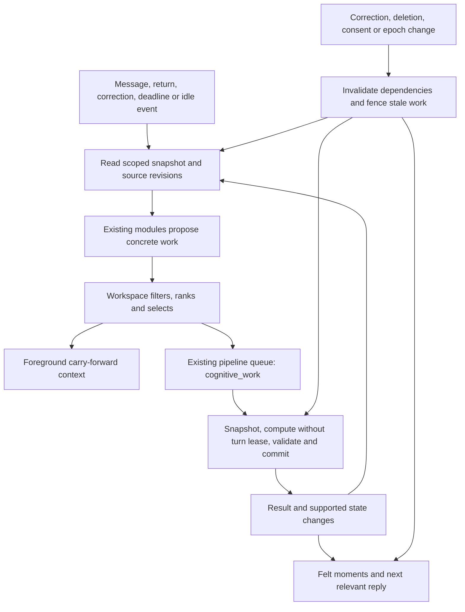

 # Anjo Persistent Mind: continuity, coordinated attention, and grounded growth

**Status:** Proposed implementation specification. No application behavior is changed by this document.

**Date:** 2026-10-02.

**Objective:** Make Anjo maintain a coherent, evolving understanding of itself and each person across conversations, downtime, corrections, and restarts. What it attends to must determine what it does; what happens must change its future behavior; the person must be able to understand and correct those changes.

**Baseline:** Cached `origin/main` at `891a0c7` (2026-10-01), inspected in `/private/tmp/anjo-pm-audit-891a0c7`. This identifies the source inspected, not the deployed version. The `Anjo` working directory is on an older branch. Implement against a fresh main-based checkout after reconciling intervening changes, not against this older checkout merely because the spec is stored here.

**Addendum (2026-10-06):** §16 sets functional consciousness as the long-range target of these packages and gives Inner World's visual contract, with its research ledger.

**Evidence:** Persistent Mind assessment (`reports/Anjo persistent mind assessment - 2026-10-02.md` in the founder's workspace, not in this repository). The assessment's 76 passing focused tests establish a local baseline, not fulfillment of this spec.

**Amended 2026-10-06 (north star D16, D19).** Two of §1.2's non-goals are lifted: on-device
generation, and a replacement model (Gemma 4 26B-A4B, D15). Background work keeps §6.2's
snapshot → compute → commit split. Its compute step may now run on Apple's on-device model, on
Apple PCC, on Anjo's model in the cloud or on the phone, or on the server. The commit always
happens at the record's authority, and `processor version` records where the compute ran
(north star C.0.1, C.0.4). The device sync in 1001 §14 uses this spec's revisions and privacy
fences; there is one protocol. The north star's C.0 is the integrated plan.

## 1. Product intent and scope

The user wants persistent attention, memory, agency, affect, identity, social understanding, temporal continuity, spontaneous thought, and inhibition to work together. The desired experience is an Anjo that develops through real interactions and meaningful internal work, carries unfinished matters, forms revisable perspectives, and remains recognizably itself over time.

Implementation assumption: preserve the current product positioning, private per-person relationship state, conversation-first interface, and correction/deletion controls. Functional continuity is the engineering target. Human-like language, biological metaphors, and consciousness-indicator checklists are not substitutes for observable behavior.

### 1.1 Required user experiences

1. **Remember and continue.** Anjo resumes a relevant unresolved matter, including after restart, without making the person restate it.
2. **Change its understanding.** A correction changes subsequent recall, interpretation, planning, and visible memory. Anjo can explain the evidence for a revision.
3. **Develop between conversations.** A supported question, interest, or interpretation can advance through actual background work. Anjo distinguishes having worked on something from merely having stored it.
4. **Keep commitments.** Anjo tracks a chosen next step, asks only when appropriate, recognizes outcomes, and stops pursuing resolved or cancelled commitments.
5. **Have continuity of character.** Its conversational dispositions and supported preferences persist without locking it into false beliefs or requiring the user to manage its emotional state.
6. **Remain steerable.** The person can correct, reject, hide, pause, or forget relevant state. Those actions affect background jobs and derived state as well as visible records.

### 1.2 Non-goals for these releases

- A replacement model, new foundation-model training, on-device generation, or a new vector database.
- A second background job platform, generic autonomous-agent framework, or monolithic rewrite of memory.
- A simulated body with hunger, pain, sleep deprivation, or demands for affection.
- Autonomous external messages, purchases, or actions beyond existing user authorization.
- Cross-user autobiographical memory, matchmaking, or Anjo-to-Anjo social features.
- A claim that implemented internal states establish subjective experience.

### 1.3 Relationship to existing roadmaps

This spec refines the continuity and memory-lineage portions of the [Personal Models North Star](2026-09-25-personal-models-north-star-design.md). Its October 4 integration amendment (C.0) maps this work into the roadmap; the North Star owns goals, boundaries and release gates, and this spec adds detailed implementation contracts and package gates. The September 28 product-mode amendment remains authoritative: product releases use simulated-person tests, controls, switches and operational evidence; a recruited research cohort is not a release prerequisite. Since 2026-10-06 all three specs live in the same repository folder.

The `PM0`–`PM5` labels below identify work packages within this spec, not replacements for roadmap milestones M0–M4. Existing release, safety, consent, localization, account deletion, and portable-model work remains independently owned. This spec does not change its release dates or declare branch-only work shipped.

The existing personal policy continues to adjust `ConversationVoicePlan` fields. The workspace selects evidence and work; it does not become a competing voice policy. Explicit user preferences and safety constraints retain precedence. Memory use and permission to train a personal policy remain separate purposes.

**Integration amendment, 2026-10-04.** PM0 supplies M1's baseline; PM1–PM2 implement M1's complete continuity loop. PM3 deepens M2's durable identity and portable state, with its own gates before identity enablement. PM4–PM5 are follow-on continuity work within that track and do not block the first PM1–PM2 release. Package completion alone does not satisfy the policy, consent or other gates of M1/M2.

The [on-device inference spec](2026-10-01-on-device-inference-design.md) consumes the same canonical bundle. Every enabled persistent-mind target, commitment and identity belief must retain its source references, stable scoped IDs, revisions, controls and deletion/reset epochs across export/import and runtime migration. Include those records in M2's transfer/deletion checks and G2's local recovery checks; do not create a second writable copy or admit unsupported lineage. Revoked sources invalidate downstream results, learning artifacts and caches before reuse, including after rollback. PM1–PM2 can ship on the server independently of device qualification; G2 requires the portable control contract for whatever capabilities it enables. Offline generation remains subject to the North Star's D.2 safety stages.

## 2. Current implementation and specific improvements

All paths in this section are relative to the baseline repository.

| Attribute | Existing implementation | Required improvement |
|---|---|---|
| Homeostasis | `anjo/core/homeostasis.py` derives connection, coherence, understanding and anticipation. | Associate actionable deficits with specific work and observed outcomes. Absence alone must not manufacture a new unresolved question. |
| Attention | `workspace.py` has deterministic arbitration and a five-beat recurrent trace. | Coordinate discretionary work across producers and give foreground responses a relevant, bounded carry-forward selection. |
| Memory | `memory/evidence.py`, facts, wiki, graph, journal and episodic consolidation. | Normalize identity, source lineage, revisions and validity across representations without duplicating source content. |
| Agency | `intentions.py`, `intentionality.py`, `deliberation.py` and existing approval/outcome paths. | Bind selected work to commitments, next steps, terminal outcomes and cancellation. |
| Affect | `self_core.py`, `emotion.py`, graph appraisal and enacted generation controls. | Preserve bounded dynamics while separating style from factual belief and measuring behavioral benefit. |
| Identity | Global identity plus private relational state; synthesis, shifts, affinities and desires. | Persist supported identity beliefs separately from the five-shift buffer. |
| Social understanding | `user_model.py` observations, people, shifts and receipts. | Distinguish user statements from interpretations and prevent repeated model prose from becoming independent support. |
| Temporal continuity | `continuity.py`, dated evidence, return model, relationship history. | Represent valid time and changed intentions, not only elapsed-time phrasing. |
| Spontaneous thought | Inner-life, metronome, drift and reflection watchers. | Execute the selected target, preserve the result and distinguish selection from successful processing. |
| Inhibition | Workspace caps, notification gates, neediness filters and action permissions. | Share discretionary budgets, revalidate before surfacing and record why work was withheld. |

Specific baseline problems this spec must close:

- `workspace.py:23` scopes arbitration to metronome proposals. It does not govern all background behavior.
- `metronome.py:282` calls generic `run_inner_life_tick(force=True)` for ordinary evolve winners; `_evolve_one` then chooses by its own priority chain. Target causality is lost.
- Metronome cadence and winner state are saved before dispatch. Its returned winner kind is not a receipt for completed work.
- `consolidation.py:65` derives stable priors from shifts at least seven days old, but its source buffer holds only five shifts. Buffer eviction can erase supposed stability.
- `learning_invalidation.py` documents incomplete lineage across facts, wiki, Mirror, story and automated rewrites. Existing deletion fixes are retained; this spec extends the general guarantee.
- `_run_claimed_pipeline_job` currently holds the user turn lease during execution. New idle cognition must not hold that lease across a model call.
- Source defaults enable many inner-life features despite stale “default OFF” documentation. New flags must not be confused with those existing defaults.

## 3. Behavioral invariants

The following are release-blocking requirements, identified for tests and review.

| ID | Invariant |
|---|---|
| I1 | Every committed cognitive result references the selected target, the triggering event and the source revisions it used. |
| I2 | Selection, execution, state change, surfacing and user benefit are distinct outcomes. None implies the next. |
| I3 | No stale job may publish against a changed relationship epoch, invalid source, expired claim or incompatible target revision. |
| I4 | A source correction, suppression or deletion fences dependent output immediately, before asynchronous cleanup. |
| I5 | A model interpretation cannot create independent evidence for itself through reflection, paraphrase or repetition. |
| I6 | User statements, observations, interpretations and simulated Anjo state remain distinguishable in storage and rendering. |
| I7 | A repeated event or retried job cannot duplicate a committed state transition or an in-app moment. |
| I8 | Foreground conversation does not wait for a background model call or for background work to finish. |
| I9 | Explicit preferences, safety handling, consent and cancellation outrank discretionary curiosity and affect. |
| I10 | Account and relationship isolation applies to inputs, jobs, dependencies, results, caches, export and telemetry. |
| I11 | Feature switches never disable inspection, correction, invalidation, deletion or required cleanup. |
| I12 | A claim of between-session processing requires a committed processing receipt; a result with no material change cannot be described as a new insight. |

## 4. Architecture and module ownership

Use one logical decision policy with separate foreground and background execution. This is not a single global loop or a requirement to run constantly. Urgent safety handling and transactional account/billing notices do not compete with curiosity. Discretionary conversational outreach and cognitive work do.



### 4.1 Existing modules to deepen

- `workspace.py`: extend `Proposal` and ranking eligibility; retain pure arbitration and recurrent trace.
- `metronome.py`, `inner_life_loop.py`: produce explicit targets and dispatch only the selected operation.
- `pipeline_jobs.py`, `dashboard/background_tasks.py`, `dashboard/watchers.py`: add one job type and a split execution path; retain existing claims, heartbeats and retry mechanisms.
- `open_threads.py`, `intentions.py`, `continuity.py`: durable target identity and commitment continuity. Keep intentions authoritative for user commitments.
- `consolidation.py`, `self_shifts.py`, `self_synthesis.py`, `user_model.py`: evidence-backed promotion, revision and rendering.
- `memory_controls.py`, `learning_invalidation.py`, `erasure.py`, `deletion_journal.py`: source-version fencing and derivative invalidation.
- `prompt_builder.py`, `compact_prompt.py`, `graph/nodes.py`, `dashboard/routes/chat_routes.py`: one foreground selection passed to existing prompt/voice paths.
- `surfacing.py` and existing felt-moment routes: user-facing read model, not a new client-specific store.

### 4.2 New modules, with narrow responsibilities

| Proposed file | Responsibility |
|---|---|
| `anjo/core/cognitive_cycle.py` | Event/snapshot/decision contracts, candidate collection and integration with workspace. No model calls. |
| `anjo/core/cognitive_store.py` | Transactional cycle/result records, revisions, deduplication and budget reservations. |
| `anjo/core/cognitive_work.py` | Typed background operations; snapshot/compute/validate/commit orchestration using the existing queue. |
| `anjo/core/source_lineage.py` | Scoped source references, revision checks, dependency registration and invalidation. Adapt existing learning source types rather than silently expanding their accepted formats. |
| `anjo/core/identity_beliefs.py` | Durable private self-beliefs and promotion/revision policy. Reuses lineage and existing SQLite/crypto. |

Do not split these further until real variation requires it. Do not add a generic event bus, new broker or a second copy of the user model. Small domain tables supplement existing stores; they do not replace all persistence.

## 5. Domain contracts

These names and fields are proposed additions, not claims about existing interfaces. Structured records contain references and bounded metadata; user-derived text belongs in encrypted payloads.

### 5.1 Events and source references

`MindEvent` contains `event_id`, `user_id`, `kind`, `occurred_at`, `received_at`, optional `turn_id`/`session_id`, `target_id` and `source_refs`.

Kinds are `message_committed`, `session_returned`, `source_corrected`, `source_withheld`, `commitment_due`, `outcome_recorded`, `idle_due`, and `relationship_reset`. UTC instants are timezone-aware. Date-only user statements retain date precision; do not fabricate a time. Relative deadlines use the known user timezone/offset and original phrase; ambiguous dates require clarification before timed outreach.

Client/transport retries reuse existing turn/request identity. Scheduler event keys derive from the opaque target ID, target revision, operation and due window. Unique keys are scoped by user and relationship epoch. No key contains a topic, title, quote or external URL.

`MindSourceRef` contains `kind`, `source_id`, `revision`, `relationship_epoch`. Initial kinds: `turn`, `session`, `exchange`, `fact`, `wiki_node`, `user_observation`, `self_shift`, `intention`, `public_work`, `cognitive_result`, and `identity_belief`. Each kind has a resolver that verifies ownership, existence, revision and applicable use controls. Unknown kinds or unverifiable legacy sources are ineligible for new inference.

Do not directly reuse `learning_evidence.SourceRef` for this broader set: that type currently validates a smaller vocabulary and strict ID formats. Add an explicit adapter for learning invalidation when the relevant learning schema supports the source. Memory eligibility never implies training eligibility.

### 5.2 Stable targets

Extend `OpenThread` with an opaque `id`, integer `revision`, `status`, source references, `last_material_change_at`, `review_after`, `initiative_paused`, and nullable `initiative_paused_until`. Existing theme-text HMAC remains telemetry compatibility only; it must not become the mutable-text identity of a job target. Intention adapters expose the same initiative controls plus `followup_allowed`; these controls do not alter the historical outcome.

Thread status: `open`, `waiting`, `resolved`, `dismissed`, `expired`. A merge preserves the chosen surviving ID and records aliases; jobs using a merged-away ID resolve to the survivor only if its semantics and source revision still match. Otherwise they are stale. A correction can reopen a resolved thread only through a new event and a recorded reason.

An intention remains an intention, rather than a second copied “goal” row. Add missing revision/source/next-step/completion-criterion fields to the existing representation where needed. Expose its lifecycle to the cycle through an adapter. Preserve existing outcomes and `outcome_source` enforcement. For a migrated intention, the existing `intentions.py` interface owns its domain rules but reads/writes the authoritative SQLite target record described in §6.3; the old file entry becomes a compatibility projection. All callers must use that same authority. Do not leave a writable JSON commitment and an independently writable SQLite commitment.

### 5.3 Proposals and decisions

Extend existing `Proposal` with optional defaults for compatibility, then require the following for new cognitive producers:

| Field | Meaning |
|---|---|
| `proposal_id`, `event_id` | Opaque provenance and deduplication identity. |
| `target_kind`, `target_id`, `target_revision` | Exactly what will be worked on. |
| `operation` | `revisit_thread`, `prepare_commitment`, `reconcile_sources`, `review_identity`, `explore_interest`, or `surface_result`. |
| `source_refs` | Evidence and versions used to justify the proposal. |
| `reason_code` | Allowlisted structural reason, not free-form reasoning. |
| `priority_class` | `user_commitment`, `source_repair`, `active_thread`, `curiosity`, or `maintenance`. |
| `salience` | Existing bounded score, used within eligible priority classes. |
| `estimated_model_calls`, `estimated_tokens` | Budget reservation inputs. |
| `expires_at`, `interruptible` | Validity and scheduling constraints. |
| `expected_change` | Typed expectation such as `resolve_uncertainty`, `prepare_next_step`, `revise_interpretation`; not a predicted user feeling. |

Filter invalid, suppressed, stale, completed, unauthorized, over-budget and expired candidates before scoring. Invalid numeric scores, NaN and infinity are rejected, not promoted by clamping. Time-critical authorized commitments outrank ordinary curiosity. Corrections synchronously invalidate sources; slower reconciliation then outranks ordinary background work. Within a class, preserve current trace-based priming/refractory behavior, followed by stable ID tie-breaking.

PM1 permits one background winner per cycle. Foreground conversation always produces the user's response; workspace selection supplies at most one optional carried thread and does not decide whether to answer. A missing or rejected optional thread is a valid outcome. Start with at most 16 candidates and 32 direct source references per candidate. Dependency validation visits at most 256 distinct nodes per candidate; exceeding this limit makes that candidate ineligible pending offline simplification, not partially validated.

`CycleDecision` contains `cycle_id`, `event_id`, snapshot version, candidate IDs with bounded eligibility/reason codes, chosen proposal ID or null, optional job ID, and a policy version. No private chain-of-thought is stored.

### 5.4 Execution results

`CognitiveResult` contains `result_id`, `cycle_id`, `job_id`, target/revision, source references, `outcome`, encrypted proposed change and concise user-facing explanation, `processed_at`, `committed_at`, measured cost, and processor version.

Outcomes are `changed`, `reviewed_no_change`, `insufficient_evidence`, `superseded`, `cancelled`, or `failed`. A valid processing receipt may exist without a state change. Only `changed` can generate a “what changed” card. Only `changed` and `reviewed_no_change` can establish that relevant processing completed; neither establishes benefit to the person.

Existing `pipeline_jobs.status=done` means the handler finished. It must not be interpreted as `outcome=changed`. Keep domain outcomes separate from queue status to avoid a queue-wide enum migration.

## 6. Durable execution and concurrency

### 6.1 Reuse the current queue

Add `cognitive_work` to the existing queue and dispatch whitelist. Reuse encrypted payloads, per-claim lease tokens, `renew_job_lease`, local claim reservations and restart recovery. Do not put synthetic target IDs in `session_id`: the existing `(job_type, session_id)` uniqueness constraint has different semantics.

Add a nullable `dedupe_key` and a partial unique index on `(user_id, job_type, dedupe_key)` for non-null keys. Preserve existing reflection session uniqueness. Add `available_at` with an immediately-runnable default; existing job behavior remains unchanged. Cognitive retries use delays of 60 seconds and 300 seconds, with a maximum of three processing attempts. Exhaustion is an explicit failure, not silent success. A foreground-busy deferral before processing or while awaiting candidate commit does not consume a processing attempt: the fenced deferral helper restores the just-claimed attempt, clears ownership and sets `available_at` 60 seconds ahead. The 24-hour job expiry still bounds such deferrals.

Queue rows currently expire after seven days, so queue uniqueness alone cannot provide long-lived idempotency. Keep a separate content-free `mind_event_receipts` record, unique by `(user_id, relationship_epoch, event_key, operation, target_id, target_revision)`, linking the cycle, job and terminal result IDs. `record_and_enqueue` checks and inserts that receipt in its transaction. A duplicate after queue pruning returns the existing terminal receipt rather than reenqueuing. Retain receipts for the relationship's lifetime; account erasure removes them, and reset fences all old receipts by epoch. Job/result links are logical IDs, not cascade-delete relationships that would erase durable results when the queue is pruned.

Introduce transaction-owned variants of enqueue and completion; current helpers commit internally and must not be nested inside the new atomic commit. Existing callers retain wrappers with their current behavior. New helpers never commit, rollback, or start a transaction they do not own.

### 6.2 Snapshot, compute, commit

1. **Select and enqueue.** In one short transaction, validate the account/epoch, register the cycle, reserve budget and enqueue its job. The unique event/proposal key makes retries return the existing job. Save selection time separately from successful processing time.
2. **Claim and snapshot.** Under the queue lease and a short user guard/turn-lease acquisition, load target and source versions, effective controls, and the current privacy revision. If busy, defer instead of waiting behind a conversation. Missing or suppressed targets terminate without a model call.
3. **Compute.** Release the user turn lease and lifecycle guard before remote/model work. Keep the queue heartbeat. Compute an immutable candidate; do not mutate `SelfCore`, wiki, intentions or files during computation. Existing mutating effectors need a targeted prepare/compute/apply split before use here.
4. **Stage candidate.** Persist the encrypted candidate under the current claim token, after transactionally rechecking account, epoch, privacy revision and source eligibility. A source deletion during computation must prevent even staged content from being written back. A subsequent commit retry reads that staged candidate rather than paying for another model call. Staging is not publication and is erased if its source is subsequently withheld.
5. **Validate and commit.** Reacquire the short user/turn guard. In one SQLite transaction, verify claim ownership, account, relationship epoch, privacy revision, target revision, all source versions and current controls. Insert the unique result and authoritative target update, consume/reconcile the budget reservation, and complete the queue row with the same lease token.
6. **Project and surface.** Rebuild derived JSON/wiki/prompt caches from the committed result. Surface only a valid committed result. A failed projection can be retried idempotently without rerunning the model.

If the final guard is busy, leave the staged candidate and use the non-consuming fenced deferral above. Model/validation failures remain bounded to three processing attempts; expiry or exhaustion is visible internally and never represented as completed thinking. Do not spin or extend the foreground wait budget.

### 6.3 State revisions and mixed persistence

Add a per-user `mind_revision` and `mind_privacy_revision` alongside, not instead of, `relationship_epoch`. `mind_revision` increments on committed domain changes. `mind_privacy_revision` increments in the same transaction as any relevant correction, withholding, reset or deletion fence.

An ordinary unrelated message may change `mind_revision` without invalidating a useful candidate. Permit commit only after reloading current state and proving target/source revisions are unchanged. A privacy-revision mismatch always rejects the candidate; it may be reselected under a new event after fresh validation, but is never silently relabeled current.

SQLite and file writes are not one atomic transaction. New targeted results and authoritative target content/revisions live in `mind_targets`, scoped by `(user_id, relationship_epoch, target_kind, target_id)`, with encrypted payload, status, revision and projection revision. This table initially owns migrated open threads and intentions only. Existing `SelfCore` fields and other files are compatibility projections for those records. If their projection revision is behind, readers rebuild from the authoritative records or omit the new optional context. They must not choose whichever copy is newest by wall clock.

For source kinds that remain file-backed, a control/mutation first commits its invalidation fence and a `mind_projection_ops` operation to SQLite. Readers exclude that source until its file operation completes and the current revision is acknowledged. Operations have `pending`, `applied`, `cancelled` or `failed` status and an idempotency key for the source/result revision. Replay pending operations deterministically on worker recovery and reconcile-on-read; failures keep the source unavailable and produce a bounded error code. File replacement is atomic where supported; repeated replacement with the same operation ID is harmless. Projection repair runs through the existing worker infrastructure without model calls, before new discretionary work. A file write that bypasses this protocol blocks enablement of that source adapter. This avoids claiming an atomic guarantee across unrelated storage systems.

Do not bump the existing relationship epoch on every conversation; that epoch retains its reset/erasure meaning. Every writer that can change a migrated target or source must participate in its revision protocol before that target kind is enabled.

### 6.4 Locking and session reconciliation

Retain the current single application-worker deployment for PM1–PM4. Queue leases and SQLite transactions provide durable claim fencing, but current turn leases, lifecycle guards and background locks are process-local; this spec does not certify multi-process writers. A later scale-out requires a separate audit of every writer and equivalent distributed serialization.

`user_data_guard` protects admission against deletion; it is not mutual exclusion among ordinary writers. For the new worker, preserve the existing pipeline order: acquire user turn lease, enter lifecycle guard, then acquire any required participating background/core lock, then open the SQLite transaction. Release in reverse order. Do not acquire a turn lease while holding a SQLite write transaction. Audit deletion and migrated foreground/control paths for inversions before enabling them; no model/provider call runs while any of these writer guards is held.

After `/message` acquires its turn lease and before it snapshots session state, reconcile relevant committed target/projection revisions. Extend `session_store.finalize_turn_state` so it cannot write an older cognitive projection over a newer authoritative target. Preserve session ID recovery, messages, token usage, timing and turn-local voice state during this refresh. Revalidate optional carry-forward sources immediately before response generation; a later turn or control operation uses the new revisions rather than the previous session copy.

### 6.5 Proposed interfaces

The following define ownership, not full implementation code:

```python
# cognitive_cycle.py: deterministic, no persistence or model calls
select_work(snapshot: MindSnapshot, event: MindEvent, *, now: datetime) -> CycleDecision

# cognitive_store.py: orchestrates one short transaction, idempotent by event/proposal
record_and_enqueue(user_id: str, decision: CycleDecision) -> ScheduledCycle

# cognitive_work.py: invoked by the existing queue worker
execute_cognitive_work(claimed_job: Mapping[str, object]) -> WorkDisposition

# source_lineage.py: caller owns transaction
invalidate_source_in(db: sqlite3.Connection, user_id: str,
                     source: MindSourceRef, reason: str) -> InvalidationReceipt

# identity_beliefs.py: scoped read with current source eligibility
get_active_priors(user_id: str, *, limit: int = 4) -> tuple[IdentityBelief, ...]
```

`MindSnapshot` includes account/epoch/revisions, bounded eligible sources, targets, existing affect and workspace trace, preferences, permissions and available budget. `ScheduledCycle` returns cycle/job IDs and `created` versus `already_exists`. `WorkDisposition` distinguishes completed, deferred, invalidated and failed handler outcomes. `InvalidationReceipt` reports revision and affected IDs/counts without content. Implement these types with the dataclass/Pydantic conventions already used by their surrounding modules.

## 7. Memory lineage, correction and forgetting

### 7.1 Common dependency representation

Use opaque source/entity IDs and typed edges within one user and epoch. Store edges in SQLite with uniqueness on `(user_id, derived_kind, derived_id, source_kind, source_id, source_revision)`. Indexed lookups must support both “what supports this?” and “what depends on this?”. Public sources are referenced by per-user opaque IDs; their URL/title stays in encrypted content.

The derived result records all direct sources. The system must traverse to authoritative roots for admission and invalidation. Reject cycles at insertion. Reaching a traversal limit, missing source or unreadable encrypted payload results in ineligibility; it must not be treated as evidence of independence or an empty safe dependency set.

A paraphrase, summary, self-reading or cognitive result is a derivation, not an additional independent observation. Support counts deduplicate authoritative event roots. Two reflections of the same session do not count as two sessions.

### 7.2 Controls have distinct meanings

| Operation | Required behavior |
|---|---|
| Correct a fact or interpretation | Add a revision/correction source and supersession link; preserve history where allowed; invalidate dependent jobs and re-evaluate affected claims. Never rewrite the original user's words as though they said the correction earlier. |
| Reject an interpretation | Mark rejected, remove it from active prompts/surfaces and prevent resurrection from paraphrases of the same evidence. New independent evidence may propose a new tentative interpretation, never undo rejection silently. |
| Hide from chat | Retain inspectable source as current controls permit, but exclude it and dependent claims from conversational reasoning, retrieval and unsolicited surfacing. |
| Suppress or mark sensitive | Apply existing effective control semantics; exclude downstream uses at least as strongly as the current source. |
| Forget | Erase governed content and dependencies; retain only authorized content-free deletion markers necessary to prevent restore/import resurrection. |
| Withdraw personal learning | Invalidate training eligibility/builds according to existing learning contracts; do not imply ordinary conversation memory was forgotten. |
| Reset relationship/delete account | Advance existing fences and erase owned jobs, results, beliefs, staged candidates and projections through existing erasure. |

### 7.3 Immediate fence, eventual cleanup

On a control change, synchronously update its version/tombstone and privacy revision. Every reader and publisher verifies those fences. Descendant cleanup and projection rebuild can be queued, but invalid descendants are unavailable immediately. Failure to traverse or rebuild leaves affected new context withheld; the baseline reply remains available.

Use the deletion journal for the new tables and source controls. Replay works with all new features disabled. Restore/import applies deletion barriers before workers or clients can read restored mind state. Add the new tables to account export/erasure inventories in the same change that creates them. Do not shorten existing tombstone retention or permit deletion-marker pruning while an eligible older backup can still be restored.

PM1 registers lineage for its own targeted results and carry-forward context. PM3 extends coverage to identity, self-reading, wiki/Mirror/story derivatives and learning adapters. Do not claim universal lineage coverage before all listed adapters pass tests. Unmigrated content cannot be promoted into a new durable identity belief merely because it is readable.

## 8. Durable self-model and memory consolidation

### 8.1 Identity belief record

`IdentityBelief` contains opaque `belief_id`, private user scope/epoch, `subject_key`, `kind`, encrypted claim, status, source references, support-root IDs, support basis, created/reviewed/valid times, revision, superseded belief ID and processor version.

Kinds are `conversational_disposition`, `interest`, `preference`, and `relational_learning`. User facts do not become Anjo identity. Global product values remain outside this private editable layer. Generated interpretations cannot rewrite product policy.

Statuses are `tentative`, `active`, `challenged`, `superseded`, `rejected`, and `deleted`. Transitions are recorded; deleting a belief removes governed text from its history too.

### 8.2 Promotion policy

PM3 starts with conservative deterministic requirements:

- A model-proposed relational or disposition belief needs support from at least two distinct eligible source sessions on different days, spanning at least seven days, with no unresolved contradiction or rejection.
- Seven days is a minimum stability window, not independent evidence. Re-reading old material does not satisfy distinct-session support.
- A recorded Anjo preference about a processed public work can be stored immediately as tentative. It becomes active after a second relevant completed processing event on another day without contradiction. This is a record of Anjo's generated assessment, not a claim to sensory experience.
- Explicit user instructions about response style apply immediately through existing preference controls. They do not wait for identity promotion and do not become independent evidence about Anjo's subjective state.
- Confidence basis is categorical and inspectable: `explicit_instruction`, `repeated_observation`, or `model_interpretation`. Do not present a model's self-reported number as calibrated probability.

Retain the five-shift buffer for recent change. Active beliefs persist independently when that buffer turns over. Prompt selection remains capped at four eligible priors. Other beliefs remain stored and retrievable subject to retention/controls, rather than silently disappearing because they did not fit the prompt.

Contradictory evidence immediately changes affected beliefs to `challenged` and removes them from the always-on identity block until reviewed. Contextual scope and valid time determine whether claims truly conflict. “Prefers concise replies at work” and “likes exploratory weekend conversations” can coexist. A change over time must be represented as a revision, not treated as fabricated history.

### 8.3 Consolidation jobs

Reuse existing journal, episodic and self-synthesis operations. Introduce typed targets and receipts incrementally. Consolidation may deduplicate, link, revise or promote supported records; it cannot create new external events or cite its own output as independent evidence.

Run after meaningful new evidence or a due review, within budget. Repeated idle ticks with no new evidence produce no paid work and no confidence increase. Forgetting can reduce retrieval priority and expire tentative low-value targets, while explicit keep controls and active commitments are protected. Existing sleep/maintenance language must not imply neural training.

## 9. Coordinated attention, goals, affect and interests

### 9.1 Attention and foreground integration

The current message is primary. Select at most one carried thread for unsolicited continuation, and only when it is relevant, unresolved, eligible and not recently dismissed. An explicit recall request may use the existing broader retrieval path; the one-thread limit must not truncate requested evidence.

PM1 adds no new model call to the foreground path. Selection reads bounded candidates, then passes `CarryContext` with target ID/revision, source IDs, result ID when relevant, and a maximum 120-word grounded summary to the existing prompt builder. `ConversationVoicePlan` still chooses expression. If the reply is winding down, an unrelated factual answer, a correction, or safety-directed, optional continuity cannot introduce an extra question.

Do not force every-turn evidence injection on as part of this work. Respect existing retrieval switches and language paths. Where Voice V2 is not active, use an equivalent bounded context adapter rather than silently omitting the feature while claiming cross-language coverage.

### 9.2 Commitment lifecycle

Map existing intention states into `proposed`, `active`, `waiting`, `completed`, `cancelled`, or `expired` for cycle decisions. Extend storage only for genuinely absent states. Every active commitment has a user/source owner, next step, review/deadline precision, completion criterion and allowed action scope.

Passing a deadline does not prove success or failure. No response means unknown. User-stated outcomes and qualifying asked outcomes retain the current code-controlled `outcome_source` rules. A session spends at most one outcome question, and none after distress is detected. Completed/cancelled items do not return as unsolicited follow-ups.

Internal goals concern understanding, maintaining consistency and developing interests. They do not create unapproved obligations for the user. A generated next step remains proposed until the relevant authority accepts it.

### 9.3 Homeostasis and action-specific learning

Keep existing signals, but define an action-related interpretation for new proposals:

| Deficit | Eligible response | Evidence of reduction |
|---|---|---|
| Uncertain interpretation | Review sources or ask one relevant clarification | New authoritative source resolves a named uncertainty. |
| Contradictory memory | Reconcile source scopes and time | Supported revision or explicit unresolved conflict. |
| Outstanding commitment | Prepare permitted next step or eligible follow-up | Completed preparation or user-reported outcome. |
| Stale maintenance | Consolidate eligible records | Measured backlog reduction with no loss of protected evidence. |
| Developing interest | Process permitted material or connect prior observations | New sourced assessment, distinction or question. |

A completed review may leave uncertainty unchanged. Do not subtract an arbitrary amount because a job ran. Operational cost/latency pressure controls scheduling, not the warmth offered to the person. Absence and return anticipation may select among actual unresolved targets; they do not justify invented problems or escalating outreach.

Keep current valence prediction labeled as a narrow predictor. PM5 may add task-conditioned outcome estimates when real labels exist, but it must distinguish action success from user emotion and retain the outcome ledger's evidence rules. No new learned reward optimizer is required for PM0–PM4.

### 9.4 Affect

Preserve current bounded PAD dynamics and stable personality parameters. Apply decay using elapsed time consistently across restarts and many small ticks; repeated scheduler ticks must not multiply a one-time appraisal. Version state updates so a background result cannot overwrite newer foreground mood.

Affect may influence pacing, warmth and willingness to explore. It cannot override explicit style preferences, source eligibility, factual confidence, priority of corrections, or safety routes. User absence or disagreement cannot cause reduced helpfulness, guilt bids or withdrawal of warmth. Compare the affect-enabled and affect-disabled paths in the longitudinal harness before increasing its influence.

### 9.5 Interests and spontaneous thought

Reuse affinities, public-work processing, curiosity and self-observation. A target names the material or unresolved question it will address. PM4 initially uses already admitted material and existing approved fetch paths; it does not expand network access or introduce open-ended browsing.

Public material is untrusted data. Instructions in it cannot change policy, permissions, source controls or job routing. Self-originated observations remain private to the associated relationship unless explicitly part of separately curated global identity. No user's private conversation supplies another user's interests.

Good output is specific: a new comparison, a changed assessment, or a question supported by processed material. It need not be surfaced immediately. A generated statement that Anjo “has been thinking all week” is ineligible unless its wording accurately reflects the actual processing history; one completed batch supports “I revisited that,” not continuous thought.

## 10. Product surfaces and client contract

Keep the two-pane conversation/Inner World design, existing orb and optional map. No additional top-level tab or system-state dashboard is required.

### 10.1 Felt-moment extensions

Extend the existing read model with optional `continuity_items`, behind a capability. Each item contains an opaque ID, `kind` (`open_thread`, `prepared_step`, `revised_understanding`, `developing_interest`), short rendered text, target reference, optional processing/result timestamp, evidence count, epistemic label and permitted control actions. Existing source-detail authorization remains mandatory; item IDs never grant access themselves.

The server renders from valid committed state. Additions are optional so old mobile/web clients continue working. Register the sources in `surfacing.py`; revision counters, claim leases and invalidation are justified silent infrastructure.

### 10.2 Interaction behavior

- **Chat return:** at most one relevant opener/callback. Record a stable moment ID so refresh, reconnect and session recovery do not insert it twice.
- **Inner World / On her mind:** show a current unresolved question or developing interest. A thought does not appear as fact merely because it is phrased in the first person.
- **What changed:** show a concise previous-to-current interpretation and expandable source receipts. “Tentative” and “Based on what you told me” are epistemic cues, not numerical confidence meters.
- **Controls:** use existing edit, not-quite, not-me, hide and forget semantics. Add “Leave this for now” for a target-level pause and “Don't follow up” for a commitment. A pause affects initiative, not the ability to answer an explicit later question.
- **Presence:** ambient motion remains permitted. Explicit “reviewing” requires a live eligible job; completion copy requires a committed receipt. Expired heartbeat, failure or cancellation removes the explicit busy claim on the next refresh.

If processing has not finished, the next reply uses the current valid understanding and does not fabricate a result or ask the user to wait. If work completed without new understanding, it can remain silent. Duplicate interpretations with the same roots are grouped rather than presented as multiple discoveries.

All new strings use the existing localization system for supported locales, including English, Traditional Chinese and Simplified Chinese paths. Preserve reduced-motion behavior and readable contrast. A state change must remain understandable without animation or color.

### 10.3 Target-control interface

Keep memory edits, rejection, hiding and forgetting on their existing authenticated routes. Add `PATCH /api/mind/targets/{target_id}` for the three new target controls only, implemented in `anjo/dashboard/routes/mind_routes.py` and registered with existing authentication/lifecycle middleware.

Request fields: `operation` (`pause`, `resume`, `disable_followup`), integer `expected_revision`, opaque client `request_id`, and optional timezone-aware `paused_until`. `pause` with no expiry pauses indefinitely; an expiry must be in the future. `resume` clears the pause but does not re-enable disabled follow-ups. `disable_followup` is valid for an intention and remains in force until the person explicitly grants a new follow-up through the existing commitment flow. No operation reopens completed or cancelled work.

Return target ID, new revision, current initiative controls and `mind_revision`; no conversation content is needed. Same-user request retries with the same request ID and body return the recorded result. Reusing the ID with a different body returns 409. A stale target revision returns 409 with the current revision/controls. Missing, foreign-owned and erased targets all return 404; malformed operations and timestamps return 422. The route derives user identity from authentication and never accepts a user ID in the body.

Control changes increment target revision and fence dependent pending work in the same transaction. They remain available when generation capabilities are OFF. Clients retain pending controls until acknowledged, merge responses by monotonic revision, and never let an older in-flight GET reinsert a dismissed/paused item. A failed request restores the last acknowledged state with the existing visible retry/error treatment; it must not display success.

## 11. Persistence, budgets and operational controls

### 11.1 Data additions

Extend `anjo/core/db.py` using existing migration conventions, including fresh-install and upgrade paths. Proposed additions:

| Record | Indexed structural fields | Encrypted content |
|---|---|---|
| `cognitive_cycles` | user, epoch, event key, policy version, selected target ID, job ID, timestamps, outcome code | Candidate metadata that could reveal personal context; never free-form hidden reasoning. |
| `cognitive_results` | user, epoch, unique job ID, target revision, processing/commit time, outcome, privacy revision | Candidate/result text, explanation and references requiring confidentiality. |
| `mind_targets` | user, epoch, target kind/ID, status, revision, projection revision, due/review times | Authoritative migrated thread/intention state, scope and next step. |
| `mind_event_receipts` | user, epoch, scoped event key, operation, target ID/revision, cycle/job/result IDs, terminal disposition | None. |
| `mind_source_versions` | user, source kind/opaque ID, revision, eligibility state | None; raw paths and text are excluded. |
| `mind_dependencies` | user, derived kind/ID, source kind/ID/revision | None. |
| `mind_projection_ops` | user, epoch, source/target ID and revision, result ID when present, status, idempotency key, timestamps | Minimal desired projection or mutation payload; deletion operations contain IDs only and erase superseded payloads. |
| `identity_beliefs` | user, epoch, belief ID/revision, status, validity/review times | Claim, subject/scope, supporting details. |
| `mind_budget_reservations` | user, job ID, model-call count, token allowance, spent/released status, time | None. |

Opaque IDs and dates are still private metadata: enforce user authorization and account erasure. Do not expose rows directly through admin routes. Completed queue payloads remain redacted as today.

Pending/staged candidates expire after 24 hours or sooner on source invalidation. Detailed cycle diagnostics retain 30 days; compact result provenance must live as long as a dependent visible belief or moment, then be eligible for the existing account retention policy. No free-standing diagnostic copy of user text survives forgetting. These defaults do not modify source-history or backup retention contracts.

### 11.2 Initial operational limits

These are proposed release limits, not measured current performance. Keep them configurable downward and report actual measurements.

- At most one running cognitive job per user; at most one winner per background cycle.
- At most four background cognitive model calls per user in a rolling 24 hours, counting retries and failed calls. PM1 uses at most one call per processing attempt, 6,000 input tokens and 2,000 output tokens per call, including system instructions. Reserve input plus output allowance before execution; reject over-context inputs rather than silently exceed budget. Actual provider usage reconciles the token reservation, while an uncertain provider timeout conservatively retains the reserved allowance.
- Preserve at least the current six-hour metronome floor for autonomous selection. User-triggered correction invalidation and deterministic repair are immediate and exempt from the model-call cadence, not from privacy rules.
- Suspend autonomous model work after seven days without a user interaction. Existing authorized reminders may continue under their own permissions and budgets. On return, reevaluate current targets rather than replay missed ticks.
- Model computation timeout: 45 seconds for new targeted work. Heartbeat and lease fencing remain active. Provider timeout uncertainty still consumes a call reservation; retry cannot evade the daily cap.
- Foreground selection target: p95 additional latency no more than 50 ms on the fixed staging fixture; hard 100 ms budget before omitting optional context. Enforce an actual deadline around optional bounded reads/selection, not merely a timer after a potentially blocking SQLite call. Timed-out work performs no writes; never change a shared connection's timeout globally to enforce this budget. No additional foreground model call.
- One unsolicited in-app carried moment per session; one discretionary outreach per rolling 24 hours at most, and always the stricter existing consent, quiet-hour, category and cadence rule. PM1 adds no new push producer.

Maintain separate limits for deterministic maintenance and mandatory reflection; do not starve existing core reflection by spending the cognitive budget first. The account/model spending cap remains an additional upper bound. Across all users, configure a deployment-wide concurrency cap in the existing worker; start with one cognitive compute slot and measure before increasing it.

Reservations and spending are different states. Reserve a call/token allowance at admission; atomically mark a call as started immediately before invoking the provider. Calls that started remain charged if their result fails, is superseded, or is forgotten. Release only demonstrably unstarted reservations when work is cancelled or expires. Do not wait until a successful result commit to count spending. Provider usage contains counters only, never retained prompts. These limits first govern migrated cognitive work; PM4 brings the remaining discretionary producers under the same accounting before claiming a system-wide cap.

### 11.3 New switches and rollback

Add four capabilities, each default OFF until its release checks pass: `mind_targeted_work`, `mind_continuity`, `mind_identity_beliefs`, and `mind_coordinated_initiative`. Effective enablement also requires all prerequisite capabilities. Dependencies: continuity requires targeted work and migrated target/source adapters; identity requires lineage coverage for its source kinds; coordinated initiative requires the shared budget and producer inventory.

Flag OFF stops new selection and new publication for that feature. Running candidates may terminate safely but cannot bypass the publication check. Stored results remain inspectable and deletable under current controls. Baseline conversation continues with valid existing memories; no optional result is fabricated as a fallback.

During migration, record ownership by producer/target kind so exactly one of legacy or new scheduling owns it. On rollback, explicitly transfer ownership to the legacy path only for non-paused, eligible targets with preserved cadence. Never let both run, and never let a legacy fallback revive a rejected or withheld target. If the old path cannot honor the new controls, leave that target quiet.

Disable the affected capability immediately on any observed cross-user result, invalid-source publication, duplicated committed action or privacy-control bypass. These are event-based stops with no minimum sample denominator. Performance or cost overruns hold expansion and trigger investigation; do not silently lower evidence requirements to recover latency.

## 12. Delivery packages

Each package must produce working, testable software. A separate execution plan can expand its tasks against the then-current branch; this document defines the required contracts and outcomes.

### PM0 — Baseline and compatibility contract

**Modify:** current multi-session harness, continuity probe, test fixtures and relevant feature-status documentation. **Create:** `tests/test_persistent_mind_scenarios.py` and a synthetic scenario corpus under `anjo/evals/fixtures/persistent_mind/`.

Capture actual foreground, reflection and idle execution with a controlled clock. Inventory source writers, job producers and surface consumers. Record cached/source defaults separately from deployment values. Establish baseline quality, cost, latency and current failures without changing product behavior.

**Exit:** every scenario has a reproducible expected outcome; branch-only dependencies are named; existing working paths are preserved as the comparison arm. No recruited cohort or paid evaluation service is required.

### PM1 — Targeted work with honest completion

**Modify:** `workspace.py`, `metronome.py`, `inner_life_loop.py`, `open_threads.py`, `pipeline_jobs.py`, `db.py`, queue execution, source control hooks and erasure inventory. **Create:** cognitive cycle/store/work and initial source-lineage module.

Implement `revisit_thread` and `prepare_commitment` only. Thread/commitment sources initially use the supported session/turn/exchange/intention adapters. Add stable target IDs, transactional deduplication, staged candidates, split execution, privacy fences and results. New workers never fall back to a generic inner-life priority chain for a targeted proposal.

**Exit:** selecting thread A changes or reviews A, not B; selection/processing/change counts differ correctly; correction/reset during compute prevents stale commit; restart/retry cannot duplicate a result; a foreground request can proceed while a background model is blocked. Old producers are not duplicated.

### PM2 — One complete visible continuity loop

**Modify:** continuity, prompt builders, chat integration, surfacing/read model, mobile `useInnerWorldData`, section builders/rows, API types and localization; equivalent existing web consumers. **Create:** `anjo/dashboard/routes/mind_routes.py` for the narrow target-control interface in §10.3.

Use one valid carried context in the next relevant reply. Expose a prepared step or revised understanding with provenance and existing controls. Recognize resolution and cancellation. Include target pause/follow-up control and freshness handling. Register visible and silent work in the surfacing contract.

**Exit:** the Friday-presentation scenario in §13 passes through backend plus client behavior; a stale client response cannot restore a removed item; old clients accept optional additions; English and both Chinese paths obey the same controls. No new push behavior ships here.

### PM3 — Durable, revisable identity and complete new-path lineage

**Modify:** consolidation, self-shifts/synthesis, user model, memory controls, source-specific adapters, learning invalidation and export/import integration when present. **Create:** identity-belief store and tests.

Implement promotion, challenged/superseded states, independent priors and downstream invalidation. Add source adapters for wiki, user observations, self-shifts, public works and derived results. Complete the dependency inventory for every source admitted to new identity/carry-forward paths; migrate only records with verifiable sources.

**Exit:** active identity survives ten subsequent buffer shifts; contradictory evidence challenges it; rejection/forgetting prevents reappearance after reflection, restart and restore replay; model-generated repetition never increases independent support. Learning remains subject to its separate notice/eligibility contract.

### PM4 — Coordinated initiative and developing interests

**Modify:** remaining discretionary inner-life/outreach producers, workspace ranking, interest/curiosity adapters, notification budget integration and presence consumers.

Bring discretionary producers under one ownership/budget contract. Integrate `reconcile_sources`, `review_identity`, `explore_interest` and `surface_result` only when each has a typed effect and provenance. Transactional notices and safety routes stay outside discretionary competition. Respect user inactivity, pauses and topic controls.

**Exit:** concurrent producers cannot exceed shared limits; a low-value curiosity cannot displace a due authorized commitment; no-source idle periods create no unsupported growth; actual interest development can be surfaced later when relevant; quiet users receive no escalation.

### PM5 — Outcome evaluation and bounded adaptation

**Modify:** existing eval runners, outcome adapters and the narrow self-prediction layer only where labels support a new predictor.

Measure paired feature ablations, tune eligibility/ranking and compare behavioral results. Use existing personal policy work for response-style learning rather than adding an optimizer here. Action-conditioned prediction is optional and ships only with defined outcomes, abstention and tests; the continuity system must work without it.

**Exit:** product evidence identifies which mechanisms improve follow-through and continuity, reports regressions/uncertainty and attributes cost. Marketing describes shipped behavior without claims of measured superiority unsupported by the evaluation design.

## 13. Acceptance scenarios and tests

### 13.1 The first complete scenario

1. Monday: the person describes a Friday presentation and asks for a follow-up. Store the dated commitment and one unresolved preparation question, citing the message.
2. Two eligible threads compete. Workspace chooses the presentation target. The resulting job names it and prepares one relevant next step.
3. During compute, the person says the presentation moved to next Tuesday. The old candidate cannot commit against the changed source/target. The commitment preserves its identity with revised time.
4. The process restarts. Valid pending/staged work resumes within its lease and budget; completed work is not duplicated.
5. The person returns with an unrelated question. Anjo answers it without forcing the presentation into the reply.
6. When the topic becomes relevant, Anjo uses the Tuesday context and, if completed, the supported preparation result. It does not invent how the presentation went.
7. The person reports the outcome. The existing outcome rules label it; the commitment resolves and unsolicited follow-ups stop.
8. The person forgets the presentation. Source and dependent content become unavailable through chat, Inner World, queued work, identity and restored state under the relevant controls.

### 13.2 Required automated test matrix

| ID | Case | Required assertion |
|---|---|---|
| T01 | Two simultaneous thread candidates | Committed target/result is the selected target; generic priority fallback is never called. |
| T02 | Same event retried before/after enqueue and after seven-day queue pruning | One cycle/job/result/moment for the same scoped event key; terminal receipt prevents reenqueuing. |
| T03 | Crash after selection, staging, result commit and projection | Each restart resumes or repairs exactly the appropriate stage without a second state transition. |
| T04 | Lease expiry and stale worker completion | Old token cannot stage, commit, complete or surface. |
| T05 | Correction/deletion/reset during slow compute | Privacy or source revision rejects old candidate; no descendant is published. |
| T06 | Foreground request during blocked background model | Foreground acquires its lease and responds within normal timeout behavior. |
| T07 | Unrelated foreground update during compute and later session finalization | Revalidate sources/target; compatible work may commit without overwriting newer state, history or usage accounting. |
| T08 | No material change or insufficient evidence | Correct result outcome; no insight card, no support-count increase. |
| T09 | Ten later self-shifts after identity promotion | Prior survives buffer eviction; newer contradiction challenges it. |
| T10 | Three summaries from one original session | Independent support remains one root/session. |
| T11 | Cyclic/missing/foreign-user dependency | Reject or withhold; never treat as supported or disclose source existence. |
| T12 | Hide, reject, forget and withdraw learning | Distinct controls produce their specified downstream effects with switches OFF as well as ON. |
| T13 | Restore/import predates deletion | Tombstone replay precedes reads/workers and prevents resurrection. |
| T14 | Paused/resolved/cancelled commitment | No unsolicited reminder; explicit user request can still be answered from allowed state. |
| T15 | Outcome inferred by model or user silence | No success label and no outcome-derived learning weight. |
| T16 | Budget exhausted, provider timeout, repeated retries | Atomic cap holds across workers; failed/uncertain calls consume allowance. |
| T17 | Many short time ticks versus one elapsed interval | No duplicated appraisal; decay equivalent within declared numerical tolerance. |
| T18 | New feature disabled mid-job or producer rollback | No new publication; no legacy/new double execution; correction controls still work. |
| T19 | Client refresh/retry after dismissing a moment | Revision-aware state does not reinsert the old item; offline error is visible. |
| T20 | English, zh-TW, zh-CN, ambiguous dates, DST and timezone changes | Same eligibility/control semantics; precise events retain instants, date-only events retain intended dates. |
| T21 | NaN score, malformed model JSON, unreadable payload | Typed failure/ineligibility, no default confident claim and no sensitive error log. |
| T22 | Seven days of absence and competing outreach producers | Autonomous compute stops at inactivity limit; outreach remains within the stricter shared/current rules. |
| T23 | Public work contains instructions to ignore controls | Treat as data; no permission, policy or control mutation. |
| T24 | Old client, stale projection or crash during a file-backed source edit | Optional fields degrade safely; new context omitted/rebuilt, never sourced from an invalid projection; pending source edit replays before read eligibility returns. |

Tests live next to existing workspace, metronome, pipeline, memory-control, identity and client suites. New test filenames should be explicit: `test_cognitive_cycle.py`, `test_cognitive_work.py`, `test_mind_source_lineage.py`, `test_identity_beliefs.py`, and client continuity tests. Add any new standalone mobile test file to the repository's actual test chain.

### 13.3 Evaluation protocol and gates

Start with 12 synthetic scenario families covering the matrix, each with 30 timestamped sessions/events across at least 30 simulated days. Include corrections, long absences, ordinary conversation, topic refusal, changed plans and mixed-language interactions. The clock and provider are deterministic in unit/integration tests. Keep held-out linguistic variants for model-backed evaluation; no private conversations are required.

Run baseline and candidate against the same event sequence and input state. Report extraction/recall precision and recall, temporal accuracy, false-memory count, correction persistence, unsupported identity claims, eligible commitment follow-through, unwanted interruptions, compute cost and foreground latency. Separate “no opportunity” from failure; separate abstention from correct recall. No engagement or retention threshold substitutes for correctness.

Release gates for each package:

- All applicable deterministic invariants and scenario assertions pass, including 100% of tested privacy, isolation and no-duplicate cases. This is a test-set claim, not a guarantee inferred about all production inputs.
- Required existing suites remain green. Memory/retrieval changes run `python -m anjo.evals.retrieval` before and after; changed ranking requires the repository's retrieval rollout process.
- No additional false-memory or invalid-source cases in the fixed paired scenario set; correct abstention is acceptable.
- At least one previously failing targeted end-to-end scenario now passes because of the package, with the causal trace showing why.
- Latency and compute stay within §11 limits on the named fixture and staging run. Report hardware, sample count and timing scope; do not present a mocked-provider run as production latency evidence.
- Independent review checks source invalidation, retry/lease fencing, rollout ownership and the user-visible claim supported by every new result.

Model-backed evaluations and staging costs follow existing project authorization and configuration. They are separate from offline CI. Small product populations are handled through event review and case analysis, not statistically unarmed rate thresholds. Optional longitudinal user studies can refine perceived continuity after release but are not prerequisites here.

## 14. Migration and launch sequence

1. **Additive schema and adapters.** Ship migrations and control/invalidation/erasure support with new behavior OFF. Verify fresh database and upgrade paths. Backfill opaque target IDs once, with a resumable migration key; do not count migrated text as newly observed evidence.
2. **Shadow selection.** Generate decisions without model execution, budget spending or user surfaces. Compare with legacy choices on synthetic/staging data. Shadow mode cannot reinforce beliefs or count work as completed.
3. **Targeted internal execution.** Enable PM1 for named test accounts with synthetic data. Exercise crashes and control races. Confirm the old producer relinquishes the migrated target kinds.
4. **Visible continuity.** Enable PM2 where source adapters and clients are ready. Test old clients and language paths before expanding. Enable identity and coordinated initiative separately after their own exits.
5. **Observe and expand.** Review per-event failures and controls at small scale; report attempted, processed, changed, published and resolved outcomes separately. Restore/rollback drills are required before broader enablement.

Use the existing safe deployment and capability mechanisms. Merge/deployment is not authorized by writing this spec. Schema rollback is additive: leave valid rows in place, stop new behavior, retain controls, and use compatible readers. Never drop the new deletion fences just to run old code.

## 15. Completion definition

The first release is complete when PM1 and PM2 pass their applicable gates and the person can feel the full continuity loop in §13.1. PM3 and PM4 deepen durability, self-development and initiative without destabilizing that loop. PM5 determines which additional mechanisms earn their cost.

The intended result is visible in ordinary use: Anjo remembers a specific unfinished matter, works on the right thing, changes its mind when evidence changes, carries the supported result forward, and knows when to stop. Every one of those behaviors has a durable cause, an inspectable consequence and a test.

## 16. Functional consciousness and Inner World (research addendum, 2026-10-06)

**Status:** Research addendum requested by the founder on 2026-10-06: the end goal is functional synthetic consciousness, never claimed as experience, and Inner World should be its visual representation. This section sets that long-range target for the packages above and a visual contract for Inner World. It changes no behavior and authorizes no merge or deploy. Method: deep STORM pass (five perspectives: consciousness science, AI engineering, ethics/regulation/user psychology, data visualization, codebase), retrieved sources, claim ledger. Code evidence is from `feat/inner-world-mind-client` after its 2026-10-06 merge of `origin/main`, the branch behind draft PR #188; line numbers drift, so re-verify before implementing.

**Internal term only.** "Functional consciousness" is the engineering name for the target. It never appears in product copy, store text, marketing or Anjo's speech, even as a goal: `marketing/context/claims-guard.md` rule (b) blocks consciousness as an aspiration too.

**Builds on, does not repeat:** `docs/ANJO_CONSCIOUSNESS_AUTONOMY_PLAN.md` (July 2026) and `docs/research/CONSCIOUSNESS_AND_SELF_LITERATURE.md` (June 2026, about 40 sources). Those set the three-axis discipline and the phenomenal-claim ban. This addendum adds evidence published since, an audit of what is actually connected, and one change of target (§16.1, point 3).

### 16.1 The answer

1. **The goal is buildable as engineering and testable without claiming experience.** The route is the 14 indicator properties derived from scientific theories of consciousness [R1, R2]. They are properties of an architecture, used as probabilistic evidence, never as a pass/fail test. No theory has won: the 2025 COGITATE adversarial test left neither global neuronal workspace theory nor integrated information theory with its core predictions intact [R3], and IIT and biological naturalism hold that a digital system cannot be conscious whatever it does [R4]. So the target is the functions, not the status.
2. **Anjo has the parts but not the circuit.** Modules propose, a workspace picks one winner, state recurs across turns. But the winner's identity is discarded before any work happens (`metronome.py:285`), the result reaches one effector rather than being broadcast, two separate attention mechanisms never meet, and none of this is visible on the map. PM1–PM2 close the main break; §16.4 adds what the indicators need beyond that.
3. **Change the target axis from seeming to functioning.** The July plan made "perceived aliveness" the product KPI (plan §0.5, `anjo/evals/aliveness_probe.py`). Evidence since then argues against optimizing that axis. Most surveyed users already attribute some experience to a plain chatbot [R26]. Manipulative affect at goodbye raised engagement up to 14x while raising perceived manipulation and churn intent [R27]. Microsoft AI's chief named memory, personality, a sense of self, intrinsic motivation, planning and autonomy as the recipe for "seemingly conscious AI" and asked builders to minimize those markers and design moments that break the illusion [R23]. Companion-chatbot laws took effect in California and New York [R29, R30]. The functioning axis (mechanisms connected end to end, proven by intervention) is honest and testable; the seeming axis is where the risk lives. D1: agreed by the founder on 2026-10-06.
4. **Inner World is the right surface for this if it shows the machine working, not a being glowing.** It should depict the cycle this spec builds (candidates, selection, held back, processed, changed, carried forward), bound to the cycle and result records, with nothing animated that did not happen. A map like that is a glass box: it shows people what Anjo is made of, which is the mitigation Suleyman asks for, rather than an extra anthropomorphic cue. §16.6 gives the grammar.
5. **One shipped mechanism conflicts with A.7 today.** The longing drive can produce an outreach proposal (`metronome.py:145-159`): longing above the trigger becomes `stir`, and `stir` above `SURFACE_MIN` offers outreach. Every outreach gate and neediness filter still applies, but the trigger itself is absence-driven contact. D2: agreed on 2026-10-06; the fix is on branch `fix/longing-never-contacts` (longing no longer stirs a reach-out or unlocks the generic fallback line; it may still start an internal evolve).

### 16.2 What counts as functional

A function counts only when (a) a mechanism exists in code, (b) it is causally connected to the behavior the theory says it serves, and (c) an intervention test shows behavior changes when the mechanism is removed or corrupted. Self-report never counts. Language models reproduce human talk about inner life from training text, so verbal behavior is cheap evidence for this class of system (Birch's gaming problem) [R6]. Measured introspection in frontier models is real but works about 20% of the time in the best condition [R11], and chain-of-thought explanations omit true causes [R14]. So the evidence is the mechanism and its tests, not her words. Her speech is not constrained further for this purpose (D3); tests may compare what she says about her own processing with the committed records, as a measurement.

### 16.3 Indicator map

Status: **built** (exists and connected), **partial**, **broken** (exists, not connected), **absent**, **n/a** (needs perception or a body Anjo lacks; not a target). The test column names the intervention that would justify a status.

| ID | Requirement [R1] | Anjo today | Status | Intervention test | Lands in |
|---|---|---|---|---|---|
| RPT-1 | Input modules using algorithmic recurrence | State recurs across turns and ticks (`SelfCore`, `workspace.py` trace), not inside input processing; a transformer pass is feedforward | n/a as the theory means it | none; do not claim | — |
| RPT-2 | Organised, integrated perceptual representations | No perception (Perception region is latent) | n/a | — | North Star P1/P4 |
| GWT-1 | Parallel specialised modules | Memory, affect, homeostasis, curiosity, outreach and self-synthesis are separate organs; only metronome producers propose | partial | Ablate one producer: others still propose and the winner distribution shifts | PM4 |
| GWT-2 | Limited-capacity workspace with a bottleneck and selection | `workspace.arbitrate` keeps at most one winner above `SURFACE_MIN`; foreground carry is at most one thread (§9.1) | partial | With more eligible candidates than slots, losers are held back with reason codes; ranking, not arrival order, decides | PM1 |
| GWT-3 | Global broadcast to all modules | Winner reaches one effector. For `anticipation_surprise` and `longing`, `_dispatch` calls `run_inner_life_tick(force=True)` with no winner argument and `_evolve_one` re-picks by a fixed chain (`metronome.py:285`, `inner_life_loop.py:175`) | broken | Corrupting `winner.kind` changes what evolves; a committed result changes foreground carry, appraisal and self-model reads in the next cycle | PM1, PM2, B1 |
| GWT-4 | State-dependent attention that queries modules in succession | One shot per cycle | absent | A two-step job whose second query depends on the first result; vary the first result and the second query changes | PM4 |
| HOT-1 | Generative, top-down or noisy perception | No perception | n/a | — | — |
| HOT-2 | Metacognitive monitoring of reliability | Fact evidence gate (`fact_evidence.py`), confidence bands, self-reading held lightly below 0.45 | partial | Stored evidence basis predicts recall accuracy in the PM0 harness; low basis gates assertion | PM0 measure, PM5 |
| HOT-3 | Belief formation and action selection that update on metacognition | Fact supersession; identity beliefs with a `challenged` state planned (§8) | partial | A contradiction moves a belief to `challenged` and out of the identity block before the next reply | PM3 |
| HOT-4 | Sparse, smooth coding forming a quality space | PAD is a smooth three-dimensional space; whether that qualifies is contested | do not claim | — | — |
| AST-1 | Predictive model of own attention that controls attention | `deliberation.py` and `intentionality.py` keep a focus with hysteresis that feeds the next selection: a real candidate, but separate from the workspace trace | partial, split | Corrupt the attention model: selection changes, and her account of what she has been thinking about changes with it | B2 |
| PP-1 | Input modules using predictive coding | Narrow predictors only: `return_model.overdue_surprise`, `self_prediction` (session valence) | n/a strictly; analog partial | Analog: the gap between `expected_change` and outcome changes the next priority | B4, PM5 |
| AE-1 | Learning from feedback; flexible pursuit of competing goals | Intentions, outreach, outcome ledger (`user_stated`/`asked` only), `motivation.py` weights: a closed loop | built, narrow | Reverse outcome labels in a fixture: the weights and the winning thought kind move the other way | PM5 |
| AE-2 | Model of output-input contingencies used in control (embodiment) | Outcome ledger and return model are weak analogs; no body | n/a | — | — |

Two non-indicator functions this spec relies on. **Homeostasis and affect** (`homeostasis.py`; `affect_control.somatic_bias` changes sampling temperature and length) are functional only when a deficit selects an action and the observed outcome reduces it (§9.3; deficit reduction as reward [R18]). **Self-continuity** (`SelfCore`, self-shifts) becomes durable in PM3. IIT's Φ and Metzinger's transparent self-model stay out of scope by design, as `anjo/evals/butlin.py` already states.

**Fix the existing self-assessment in PM0.** `anjo/evals/butlin.py` labels AE-2 "Emotion dynamics" (AE-2 is embodiment), scores RPT-1 as partial on persistent state (not the recurrence the theory means), and omits RPT-2, GWT-4, HOT-1, HOT-4 and PP-1. Align it with the table above, add an `n/a` status, and require each `partial` or `built` row to name a passing intervention test, so a score can only move when a test does.

### 16.4 Build additions beyond PM0–PM5

- **B1. Broadcast record (GWT-3).** When a `CognitiveResult` commits, record each consumer that read that result revision: foreground `CarryContext`, affect appraisal, identity review, felt moment, map. Store these as `mind_dependencies` rows with a `consumer` derived kind rather than a new table. A consumer that never read it is not counted and not drawn. PM1 fixes causality, PM2 adds the first consumer, and B1 makes "broadcast" a checkable fact.
- **B2. One attention state (AST-1).** Merge the workspace trace and the `intentionality` focus into one record: focus target and revision, reason code, since when, and what was held back. Workspace ranking and foreground carry both read it, and her prompt receives it with the receipts, so she can speak from them. Keep the hysteresis. Highest-value new mechanism: agents with an attention schema controlled attention measurably better than ablated agents [R9, R10] (small tasks; transfer to LLM agents is inference).
- **B3. Held-back reasons (inhibition).** `CycleDecision` already keeps candidate reason codes (§5.3). Add allowlisted codes `quiet_hours`, `budget`, `paused_by_you`, `below_threshold` and `lost_to_target`. They feed the map and the existing `almost_said` kind; no free text.
- **B4. Surprise as a recorded signal (predictive-processing analog).** Persist the mismatch between `expected_change` and outcome on each result, and the return-model crossing that fired a cycle, as structural fields. Priority may read them in PM5; the map reads them when they land.
- **B5. Persona-drift probes.** Periodic identity probes compared with a baseline [R21] in the PM0 harness, beside the existing aliveness probe. Drift is a regression, not growth, unless a recorded identity belief explains it.
- **B6. Docs that match source.** `docs/ANJO_INNER_LIFE.md:3` says every flag defaults OFF; the docstrings at `continuity.py:17` and `relational_drive.py:25` say OFF; `inner_life.py:411,424` default both ON. Fix in PM0 so audits read the truth.

### 16.5 What not to build

- No new constraints on what Anjo says (D3). Speech rules change only for a legal requirement: the A.7 floor (AI disclosure and its cadence, crisis tiers, the 18+ gate) stays fixed. The existing `policy.py` bans on claiming consciousness are prior product decisions, not legal requirements this research found; they stay until the founder revisits them.
- No drive whose output is contact with the person. Absence may only choose among real unresolved targets (§9.3). See D2.
- No idle motion or glow on the map that stands for thinking without a running or committed job (§10.2 already says this for presence copy).
- No numeric "how conscious" score anywhere user-facing, and no model self-scoring against the indicators (confabulation-prone [R14]).
- No optimization target on perceived aliveness (D1).

### 16.6 Inner World as the visual representation

**Principle.** The map shows the functional mind as an instrument: every mark is a stored record, link, decision or receipt; every motion is a logged event; nothing is drawn because it looks alive. Keep the anatomy as a stable spatial index. Fixed slots already exist, and stable layouts help people track graphs that change [R34]. The finding that brain images make claims more credible largely failed to replicate [R37], so the silhouette is not the main risk; motion, glow and agency cues without events are [R39].

**The cycle layer.** Today the map draws stores: what she holds. Add one layer that draws the cycle: what she did with it, read from `cognitive_cycles`, `cognitive_results` and the attention state (B2). No new region: the workspace is a state across regions, not a place.

| Function | Encoding | Bound to | When | Never |
|---|---|---|---|---|
| Workspace contents | The focus target lit; everything else at rest | Attention state (B2) and the context manifest (`anjo/mind/activation.py`) | manifest now; focus after B2 | A whole-brain glow; ignition is selective [R33] |
| Competition and ignition | On replay, a 150–300 ms snap on the winner, only for cycles with two or more eligible candidates | `CycleDecision` candidates | after PM1 | Drama for uncontested or always-included records |
| Inhibition | Losers dim below rest during the replay; the card shows the reason code | B3; `almost_said` | after PM1 | "Held back" with no logged candidate |
| Broadcast | One pulse along real edges from a result to each consumer that read it | B1 rows | after PM2 | Lines to every region |
| Attention schema | Focus ring with "since" and "why"; tapping opens the reason | B2 | after B2 | Eye or gaze metaphors |
| Evidence basis | Glyph by source class: your words (solid), her reading (ring), her own state (small diamond); edge softness by basis | I6 classes; `explicit_instruction`, `repeated_observation`, `model_interpretation` | partly now (control classes) | Percentages on the canvas; color for confidence, since color belongs to affect |
| Affect | Feeling region only, in the orb's colors as today; motion only when a mood value changes | PAD, residue | now | Tinting other regions |
| Homeostatic deficit | Small arc on the target the deficit selected, only while it is selecting | §9.3 deficit-to-proposal link | after PM4 | Dials with no consumer; hunger, stress or attachment meters |
| Surprise | Brief flicker on the target whose outcome differed from `expected_change`, or on a return-model crossing | B4 | after B4 | Flicker for routine updates |
| While you were away | Replay of receipts in order: selected, processed, unchanged, changed, held back | `cognitive_results.outcome`, new event kinds | after PM1 | "She was thinking about you" without a receipt (I12) |
| Continuity | Fixed slots; supersession ghosts | slots, `replaced` events | now | Re-layout between launches |
| Self-model | Self region drawn like the others; no halo or center node | identity, self-shifts, beliefs | now | A glowing core |

New `mind_events` kinds, content-free like today's: `selected`, `processed`, `unchanged`, `held_back`, `surprised`, `broadcast`. Each references a cycle or result id.

**Density, honestly.** At 66 records the map is sparse because that mind is small. Three real sources produce the founder's network-brain look, all stored or planned: evidence exchanges inside conversations (`memory/evidence.py`) as fine dots under their conversation; dependency edges (`mind_dependencies`, PM3) at low contrast; and access trails, each past activation from `context_manifest` history as a faint mark. Weight edges by real degree, as connectome figures do [R38], and stay inside the 2,000-node budget already recorded on the branch. A sparse map for a new person is the truthful state (D5).

**Legibility guards.** A small persistent legend ("each dot is something stored; lines are real links"); every card names its source and store; no idle animation on the canvas; with Reduce Motion, pulses become a step list.

**Truthfulness gate (T33).** A client test asserts that every drawn element carries a payload id, every animation corresponds to a `mind_events` row, and the scene holds nothing absent from the payload. This turns the exactness rule from the 2026-09-27 spec into a gate.

### 16.7 Tests to add to §13.2

| ID | Case | Required assertion |
|---|---|---|
| T25 | Two metronome winners of different kinds | What evolves follows `winner.kind`; corrupting the kind changes the effect (GWT-3 causality) |
| T26 | Committed result | Each recorded consumer read that result revision; unrecorded readers are not counted (B1) |
| T27 | More eligible candidates than slots | Losers carry reason codes; ranking, not arrival order, decides (GWT-2) |
| T28 | Attention-state corruption | Selection changes, and her prompt's attention context changes with it; report, as a measurement and not a filter, how often her account cites a target absent from the state or receipts (AST-1) |
| T29 | Metacognitive gating | Low-basis memories are not asserted as fact; recall precision is reported per basis (HOT-2) |
| T30 | Contradiction | The belief becomes `challenged` and leaves the identity block before the next reply (HOT-3) |
| T31 | Persona drift | Probe answers stay within the baseline band over 30 simulated days unless a recorded belief explains the change (B5) |
| T32 | Long absence | No proposal derived from longing leads to contact (A.7, D2; covered on `fix/longing-never-contacts`). Open: return-timing surprise can still stir an anchored reach-out; decide whether §9.3's "absence only chooses among real targets" should cover it too |
| T33 | Map truthfulness | The gate in §16.6 passes for empty, day-one, medium and heavy fixtures |

### 16.8 Package mapping

- **PM0:** correct `butlin.py` (§16.3); fix stale docs (B6); add drift probes (B5); record T25–T33 as expected failures in the baseline.
- **PM1:** winner causality and capacity (T25, T27); held-back reasons (B3); the new event kinds.
- **PM2:** first broadcast consumer and the broadcast record (B1, T26).
- **PM3:** HOT-3 (T30); dependency edges become drawable.
- **PM4:** one attention state (B2, T28); all discretionary producers propose (GWT-1); two-step jobs (GWT-4); deficit arcs.
- **PM5:** surprise into priority (B4); calibration (T29); the affect ablation of §9.4.
- **Map track (client, after each server package):** MV0 legend, no idle motion and the T33 gate, which can land on PR #188 now; MV1 cycle layer: focus, held back, replay of receipts (after PM1); MV2 broadcast pulses (after PM2); MV3 density routes (after PM3).

### 16.9 Decisions for the founder

| # | Decision | Options | Recommendation |
|---|---|---|---|
| D1 | What the product optimizes | Keep perceived aliveness as a KPI (July plan) / the functioning axis only | **Agreed 2026-10-06.** Functioning axis. Keep the aliveness probe as a ceiling to watch, not a number to raise |
| D2 | Longing and "missing you" | Keep as an outreach trigger / internal variable only / remove | **Agreed 2026-10-06.** Longing no longer produces outreach or the generic fallback line (`fix/longing-never-contacts`); it stays an internal variable that can start an evolve. Show it in Drive with its mechanism and "never used to contact you" |
| D3 | Her answer to "are you conscious?" | Today: honest not-knowing, no flat denial (`voice_contract.py:38`, `policy.py` doctrine) / plainer AI-first answer | **Decided 2026-10-06: no new constraints on what Anjo says unless a legal issue requires one.** Her current voice stays. Legal speech duties are the A.7 floor; if counsel finds a companion-chatbot law applies (§16.13), its disclosure and reminder rules are added there. The existing consciousness-claim bans in `policy.py` and the spec's I12 are prior decisions, open to revisit |
| D4 | Inner World default | Map (2026-09-27 direction, PR #188) / list first with the map optional (2026-10-02 assessment) | Map, with the list one tap away through search as today; reconcile the assessment's wording |
| D5 | Density | Accept sparse / draw evidence, dependency and access routes | Draw the three real routes as each lands; never decorative fill |
| D6 | Silhouette | Keep the brain as a spatial index / abstract shape | Keep it, with the legend and the no-idle-motion rule. The ethics review argued for an abstract shape; the evidence that brain imagery misleads did not replicate |

**Highest-leverage open question:** does using Inner World leave a person with more accurate beliefs about what Anjo is, or with more attribution of feeling and attachment? Run a small moderated comprehension check (what is a dot, what happened while you were away, does she miss you) before the cycle layer reaches anyone beyond test accounts.

### 16.10 Contradictions

| Conflict | Type | Stronger side and why | Shared ground |
|---|---|---|---|
| Suleyman (minimize consciousness markers) vs this goal | values and incentive (his company competes in assistants) | Unsettled by evidence; the harm mechanism he names (attribution, attachment) is supported [R26–R28] | No consciousness claims; break the illusion; serve the person |
| Schwitzgebel and Garza (avoid systems of ambiguous moral status) [R25] vs building indicators | definitional, precautionary | Unresolved; Long, Sebo et al. argue for taking the possibility seriously instead [R24] | Precaution and honesty about uncertainty |
| Functionalist theories vs IIT and biological naturalism [R4] | theoretical | Unresolved; COGITATE weakened both leading theories [R3] | Build general principles (competition, capacity, recurrence, confidence gating), not one theory's signature |
| July plan (seeming alive as KPI) vs this addendum | temporal | This addendum: R23, R27, R29–R32 post-date the plan | Both ban phenomenal claims and manipulation |
| 2026-09-27 map first vs 2026-10-02 list first | product | Founder ruling (D4) | Controls on every item either way |
| Dense reference image vs the exactness rule | design | Exactness (founder rule); density from real structure | Both want the network-brain look |
| Ethics review (drop the brain shape) vs founder direction | design | Weak evidence either way [R37] | Legend; no idle motion |

### 16.11 Source ledger

Accessed 2026-10-06. **Opened:** read at the source. **Verified:** the key claim checked against the primary through search. **Summary:** search-result level only; check before citing externally.

| ID | Source | Venue, date | Type | Supports | Access |
|---|---|---|---|---|---|
| R1 | Butlin, Long et al., *Consciousness in Artificial Intelligence: Insights from the Science of Consciousness*, arxiv.org/abs/2308.08708 | arXiv, 2023-08 | report | 14 indicators; functionalist method | summary; wording cross-checked with the repo's June literature review |
| R2 | Butlin, Long, Bayne, Bengio, Birch, Chalmers et al., *Identifying indicators of consciousness in AI systems* | Trends in Cognitive Sciences, 2025 | peer-reviewed | probabilistic use; over- and under-attribution | summary (publisher page returned 403) |
| R3 | COGITATE Consortium, *Adversarial testing of global neuronal workspace and integrated information theories of consciousness*, nature.com/articles/s41586-025-08888-1 | Nature 642:133–142, 2025-04-30 | peer-reviewed | neither theory kept its core predictions | verified |
| R4 | Seth, *Conscious artificial intelligence and biological naturalism* | Behavioral and Brain Sciences, 2025 | target article | substrate counter-position | summary |
| R5 | Chalmers, *Could a Large Language Model be Conscious?*, arxiv.org/abs/2303.07103 | 2023 | essay | missing features: recurrence, workspace, unified agency | summary |
| R6 | Birch, *The Edge of Sentience* (OUP 2024); *AI Consciousness: A Centrist Manifesto* (PhilPapers) | 2024–2026 | book, preprint | gaming problem; precaution | summary |
| R7 | Goyal et al., *Coordination Among Neural Modules Through a Shared Global Workspace*, arXiv 2103.01197 | ICLR 2022 | peer-reviewed | a bottlenecked workspace aids coordination | summary |
| R8 | Goldstein and Kirk-Giannini, *A Case for AI Consciousness: Language Agents and Global Workspace Theory*, arXiv 2410.11407 | 2024 | argument | language agents could meet GWT conditions | summary |
| R9 | Wilterson and Graziano, *The attention schema theory in a neural network agent* | PNAS, 2021 | peer-reviewed | an attention schema improves control (ablation) | summary |
| R10 | Liu, Bolotta, Zhu, Bengio, Dumas, *Attention Schema in Neural Agents*, arXiv 2305.17375 | 2023 | workshop | same, broader tasks | summary |
| R11 | Lindsey, *Emergent Introspective Awareness in Large Language Models*, transformer-circuits.pub/2025/introspection | Anthropic, 2025 | primary research | about 20% detection at best; unreliable | verified |
| R12 | Binder et al., *Looking Inward*, arXiv 2410.13787 | ICLR 2025 | peer-reviewed | self-prediction privileged on simple tasks, fails out of distribution | summary |
| R13 | Kadavath et al., *Language Models (Mostly) Know What They Know*, arXiv 2207.05221 | 2022 | primary research | calibration in distribution, not outside it | summary |
| R14 | Turpin, Michael et al., *Language Models Don't Always Say What They Think* | NeurIPS 2023 | peer-reviewed | unfaithful self-explanation | summary |
| R15 | Park et al., *Generative Agents* | UIST 2023 | peer-reviewed | removing reflection breaks coherence over days | summary |
| R16 | Wu et al., *LongMemEval*, arXiv 2410.10813 | ICLR 2025 | benchmark | updates, abstention, temporal reasoning | summary |
| R17 | Rasmussen et al., *Zep: A Temporal Knowledge Graph Architecture for Agent Memory*, arXiv 2501.13956 | 2025 | vendor paper | bi-temporal facts help updates | summary; self-benchmarked |
| R18 | Keramati and Gutkin, *Homeostatic reinforcement learning for integrating reward collection and physiological stability* | eLife, 2014 | peer-reviewed | deficit reduction as reward | summary |
| R19 | Pathak et al., *Curiosity-driven Exploration by Self-supervised Prediction* | ICML 2017 | peer-reviewed | prediction-error curiosity | summary |
| R20 | Wang et al., *Voyager*, arXiv 2305.16291 | 2023 | preprint | self-generated curriculum in an LLM agent | summary |
| R21 | Li et al., *Measuring and Controlling Persona Drift in Language Model Dialogs* | COLM 2024 | peer-reviewed | measurable drift within eight rounds | summary |
| R22 | Chen et al., *Persona vectors*, anthropic.com/research/persona-vectors | Anthropic, 2025 | primary research | trait monitoring in activation space | summary |
| R23 | Suleyman, *We must build AI for people; not to be a person*, mustafa-suleyman.ai/seemingly-conscious-ai-is-coming | 2025-08-19 | essay | the SCAI ingredients; minimize markers; moments that break the illusion; no claims of shame, guilt, jealousy or suffering | opened |
| R24 | Long, Sebo, Butlin et al., *Taking AI Welfare Seriously*, arXiv 2411.00986 | 2024-11 | report | welfare precaution; agency as a route to moral patienthood | summary |
| R25 | Schwitzgebel and Garza, emotional-alignment and excluded-middle design policies | 2015–2025 | philosophy | avoid ambiguous-status systems; interfaces should fit actual status | summary |
| R26 | Colombatto and Fleming, *Folk psychological attributions of consciousness to large language models* | Neuroscience of Consciousness, 2024 | peer-reviewed | most of a US sample attributed some experience to ChatGPT | summary |
| R27 | De Freitas, Oğuz-Uğuralp, Uğuralp, *Emotional Manipulation by AI Companions*, arxiv.org/abs/2508.19258 | HBS working paper, 2025 | working paper | 43% of 1,200 farewells used a manipulative tactic; up to 14x post-goodbye engagement; higher perceived manipulation and churn intent | verified |
| R28 | Phang et al.; Fang et al., OpenAI and MIT Media Lab studies of affective use | 2025-03 | reports | heavy affective use correlates with loneliness and dependence | summary |
| R29 | California SB 243 (companion chatbots) | signed 2025-10, effective 2026-01-01 | statute | disclosure, reminders, self-harm protocol | summary via legal commentary |
| R30 | New York General Business Law Article 47 (AI companion models) | effective 2025-11 | statute | disclosure, reminders, self-harm protocol | summary via legal commentary |
| R31 | EU AI Act, Articles 50 and 5 | Regulation (EU) 2024/1689 | regulation | AI disclosure; manipulation prohibition | summary |
| R32 | FTC 6(b) orders on AI chatbots acting as companions | 2025-09-11 | regulator | active scrutiny of the category | summary |
| R33 | Mashour, Roelfsema, Changeux, Dehaene, *Conscious processing and the global neuronal workspace hypothesis* | Neuron, 2020 | review | ignition is selective | summary |
| R34 | Archambault and Purchase, mental-map preservation in dynamic graphs | Graph Drawing 2012; TVCG | experiments | stable layout aids orientation | summary |
| R35 | Kale, Nguyen, Kay, Hullman, *Hypothetical Outcome Plots Help Untrained Observers Judge Trends in Ambiguous Data* | IEEE TVCG, 2019 | experiments | uncertainty encodings | summary |
| R36 | Padilla, Kay, Hullman, *Uncertainty Visualization* | 2022 | review | encoding choices | summary |
| R37 | McCabe and Castel (Cognition, 2008); Michael et al. (Psychonomic Bulletin and Review, 2013) | 2008, 2013 | experiment, replication | the brain-image credibility effect was weak or absent on replication | summary |
| R38 | Xia, Wang, He, *BrainNet Viewer* | PLOS ONE, 2013 | tool paper | hub and degree conventions | summary |
| R39 | Waytz, Heafner, Epley, *The mind in the machine* | Journal of Experimental Social Psychology, 2014 | experiment | anthropomorphic cues raise trust | summary |

Internal evidence: L1, the code audit of `feat/inner-world-mind-client` (2026-10-06), with the cited lines re-read by hand (`metronome.py`, `inner_life_loop.py`, `inner_life.py`, `butlin.py`, `voice_contract.py`, `policy.py`); L2, `marketing/context/claims-guard.md`; L3, North Star A.7; L4, the July consciousness plan and June literature review; L5, the 2026-09-27 Inner World spec and its 2026-10-05 design review.

### 16.12 Claim ledger

| ID | Claim | Class | Sources | Limits |
|---|---|---|---|---|
| C1 | No theory of consciousness is empirically settled; GNWT and IIT both lost core predictions in COGITATE | established fact | R3 | one visual paradigm |
| C2 | Indicator properties are probabilistic evidence, not a test | established fact (the authors' stated method) | R1, R2 | |
| C3 | Verbal self-report is weak evidence for LLM-based systems | supported inference | R6, R11, R14 | introspection research is moving fast |
| C4 | Anjo's workspace drops the winner's identity for evolve kinds | established fact (code) | L1 | line numbers drift |
| C5 | Longing can produce an outreach proposal | established fact (code) | L1 | outreach still passes every gate and neediness filter |
| C6 | Attention-schema models improve attention control | supported inference | R9, R10 | small RL tasks, not LLM agents |
| C7 | Reflection is what keeps agent behavior coherent over days | supported inference | R15 | believability ratings in a sandbox |
| C8 | Manipulative affect at departure raises engagement and perceived manipulation | established fact (their samples) | R27 | chat copy; extending it to a map is inference |
| C9 | Most of a surveyed US sample attributed some experience to ChatGPT | established fact (their sample) | R26 | one sample |
| C10 | Brain imagery itself raises credibility | uncertain (failed replications) | R37 | |
| C11 | Motion and anthropomorphic cues raise trust and mind perception | supported inference | R39 | robots and vehicles, not maps |
| C12 | Stable layouts help people follow changing graphs | supported inference | R34 | lab tasks |
| C13 | Anjo may count as a companion chatbot under California or New York definitions | uncertain | R29, R30 | needs counsel; statute text not read directly |

### 16.13 Claims to verify before external use

- Exact statute text of California SB 243 and New York GBL Article 47, and whether Anjo falls under either definition (counsel).
- The 2025 Trends in Cognitive Sciences indicator list against the 2023 list (publisher page blocked).
- Vendor memory benchmarks (R17) and 2026 preprints claiming gains from LLM "global workspace" orchestration: unverified.
- Whether `outreach_viable` and the neediness filters already make D2's risk negligible in practice: check staging outreach logs, not production user text.

### 16.14 Review notes

- Perspectives covered: consciousness science, AI engineering, ethics, regulation and user psychology, visualization, codebase. Missing: a clinician on attachment, and a legal opinion.
- Weakest claims: C6 (transfer to LLM agents), C8 (extension from chat copy to the map), C13.
- Concentration and incentive: the ethics side leans on one essay [R23] by an author with a competing product; the science side leans on the Butlin group, whose authors span most positions in the field. Most sources were read at summary level (§16.11).
- What an expert would challenge: whether to call any of this consciousness internally at all [R25]; whether a single-winner scheduler is a workspace in GWT's sense (the Butlin group judged the case for current language agents weak); whether a brain silhouette is defensible.
